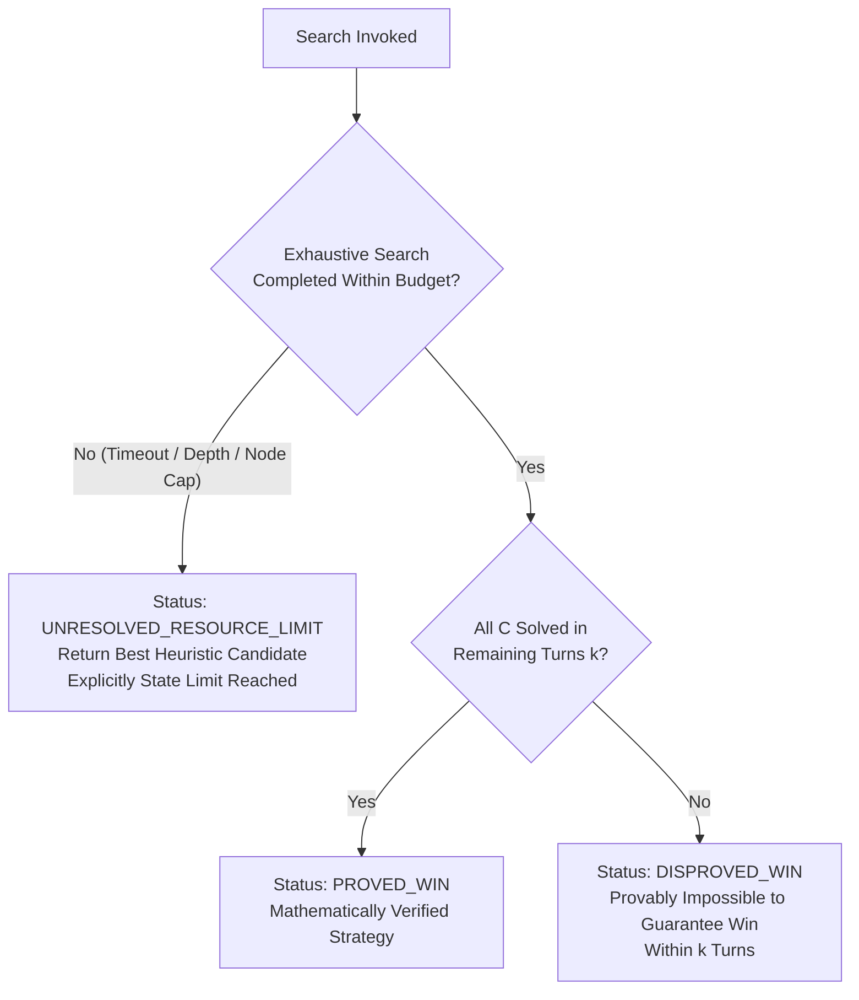

# docs/ALGORITHMS.md — Algorithmic Formulations & Theoretical Analysis

## 1. Formal Mathematical Formulation

Wordle is modeled as a **finite-horizon, partially observable, deterministic observation game** (a subclass of POMDPs where transition dynamics are deterministic given the hidden parameter $w^* \in A$).

### 1.1 State Spaces & Vocabulary
- **Secret Answer Space ($A$):** A finite dictionary of candidate target words, $|A| \approx 2,309$.
- **Allowed Guess Space ($G$):** A finite vocabulary of legally acceptable guesses, $|G| \approx 12,972$, with $A \subseteq G$.
- **Hidden State ($w^*$):** A single true target word $w^* \in A$, chosen uniformly at random at turn $t = 0$.
- **Belief State ($C_k$):** The set of surviving candidate words consistent with all historical observations up to turn $k$:
  $$C_0 = A, \quad C_k \subseteq A$$
- **Feedback Space ($\mathcal{P}$):** The set of ternary feedback vectors of length 5:
  $$\mathcal{P} = \{0, 1, 2\}^5, \quad |\mathcal{P}| = 3^5 = 243$$
  where $2 \equiv \text{Green (Correct)}$, $1 \equiv \text{Yellow (Present)}$, $0 \equiv \text{Grey (Absent)}$.

---

## 2. Exact Feedback Semantics & Multi-Pass Evaluation

Given a guess $g = (g_0, \dots, g_4)$ and a target candidate $w = (w_0, \dots, w_4)$, the feedback function $\mathcal{F}: G \times A \to \mathcal{P}$ must account for letter multiplicity without over-crediting letters.

### 2.1 Multi-Pass Feedback Algorithm
```text
Algorithm: EVALUATE_FEEDBACK(guess g, target w)
Input: 5-letter strings g and w
Output: Feedback vector p in {0, 1, 2}^5

1. Initialize p = [0, 0, 0, 0, 0]
2. Initialize target_counts = frequency table of characters in w
3. // Pass 1: Exact matches (Green)
   for i = 0 to 4 do
       if g[i] == w[i] then
           p[i] = 2
           target_counts[g[i]] -= 1
       end if
   end for
4. // Pass 2: Positional mismatches (Yellow)
   for i = 0 to 4 do
       if p[i] != 2 and target_counts[g[i]] > 0 then
           p[i] = 1
           target_counts[g[i]] -= 1
       end if
   end for
5. return p
```

### 2.2 Critical Edge-Case Verifications
- **Case 1: Multiple in Guess, Single in Target**
  - Target: `A B I D E`
  - Guess:  `S P E E D`
  - Feedback: Tile 2 (`E`) is Yellow (consumed); Tile 3 (`E`) is Grey; Tile 4 (`D`) is Green.
  - Result: `[0, 0, 1, 0, 2]`
- **Case 2: Multiple in Target, Single in Guess**
  - Target: `G E E S E`
  - Guess:  `C R A N E`
  - Feedback: Position 4 matches exact `E` (Green). No unconsumed `E` remains for an earlier position.
  - Result: `[0, 0, 0, 0, 2]`
- **Case 3: Equal Multiplicities Permuted**
  - Target: `A L L O Y`
  - Guess:  `L O L O L`
  - Feedback: Pos 2 matches `L` (Green); Pos 0 `L` matches remaining `L` (Yellow); Pos 4 `L` exhausted (Grey). Pos 1 `O` matches `O` (Yellow); Pos 3 `O` exhausted (Grey).

---

## 3. Candidate Filtering & Belief State Updating

Given prior candidate set $C_k$, guess $g$, and observed pattern $p^*$:
$$C_{k+1} = \{ w \in C_k \mid \mathcal{F}(g, w) = p^* \}$$

### Properties:
1. **Monotonicity:** $C_{k+1} \subseteq C_k$ and $|C_{k+1}| \le |C_k|$.
2. **Termination:** If $|C_{k+1}| = 1$ and $p^* = [2, 2, 2, 2, 2]$, the game is won.
3. **Contradiction Detection:** If $C_{k+1} = \emptyset$, either an invalid observation was entered by the user, or $w^* \notin A$.

---

## 4. Strategy 1: Fast Information-Theoretic Heuristic (Shannon Entropy)

### 4.1 Theoretical Foundation
Under the assumption of uniform prior over surviving candidates ($P(w) = \frac{1}{|C|}$), playing guess $g$ induces a partition of $C$ into at most 243 disjoint subsets:
$$C_{g, p} = \{ w \in C \mid \mathcal{F}(g, w) = p \}, \quad \text{where } \bigcup_{p \in \mathcal{P}} C_{g, p} = C$$

The probability of observing pattern $p$ given guess $g$ is:
$$P(p \mid g) = \frac{|C_{g, p}|}{|C|}$$

The **Shannon Information Gain (Entropy)** of guess $g$ measures the expected reduction in uncertainty:
$$H(g) = - \sum_{p \in \mathcal{P}, |C_{g, p}| > 0} P(p \mid g) \log_2 P(p \mid g) \quad \text{[bits]}$$

The **Expected Remaining Candidate Count** is:
$$E[|C'| \mid g] = \sum_{p \in \mathcal{P}} P(p \mid g) \cdot |C_{g, p}| = \frac{1}{|C|} \sum_{p \in \mathcal{P}} |C_{g, p}|^2$$

### 4.2 Objective Function & Tie-Breaking
The greedy strategy selects:
$$g^* = \arg\max_{g \in G} H(g)$$

**Tie-Breaking Hierarchy:**
1. Maximize $H(g)$.
2. If $|H(g_1) - H(g_2)| < 10^{-6}$, prefer $g \in C$ over $g \in G \setminus C$. Playing a word inside $C$ gives an immediate winning chance $P(\text{win}) = \frac{1}{|C|}$, whereas playing outside $C$ yields $P(\text{win}) = 0$.
3. Lexicographical order (alphabetical) for deterministic reproducibility.

### 4.3 Computational Complexity
- For candidate set $C$ and guess pool $G$, computing entropy for all $g \in G$ requires:
  $$\mathcal{T}_{\text{entropy}} = \mathcal{O}(|G| \cdot |C| \cdot L)$$
  where $L = 5$ is word length.
- With $|G| \approx 12,972$ and initial $|C| = 2,309$, this involves $\approx 3 \times 10^7$ operations ($\approx 10\text{--}40\text{ ms}$ in optimized TypeScript).
- Optimization: In subsequent turns where $|C| \le 200$, computation takes $< 2\text{ ms}$.

---

## 5. Strategy 2: Bounded Deeper Search (Minimax Game-Tree)

While greedy entropy minimizes the *average* partition size in the immediate next step, it is myopic: it can leave difficult partitions with high worst-case branching (e.g., words ending in `_OUND` or `_IGHT`) that require more than the remaining turns to resolve.

### 5.1 Game-Tree Formulation
We formulate deeper search as an **adversarial / expectiminimax tree** of depth $d$, minimizing the worst-case number of guesses to guarantee a win:

- **Max Node (Turn $t$, Agent):**
  Choose guess $g \in G$ to minimize depth-to-win.
- **Min / Chance Node (Nature / Wordle):**
  Adversarial Wordle returns the worst-case pattern $p \in \mathcal{P}$ that maximizes remaining difficulty:
  $$d^*(C) = 1 + \min_{g \in G} \max_{p \in \mathcal{P}, C_{g, p} \neq \emptyset} d^*(C_{g, p})$$

### 5.2 Pruning & Memoization Strategies
1. **Base Cases:**
   - If $|C| = 1$: $d^*(C) = 1$ (guess the single word; immediate win).
   - If $|C| = 2$: $d^*(C) = 2$ (guess one candidate; if correct, win in 1; if not, remaining candidate wins in 2; worst-case 2, expected 1.5).
2. **Worst-Case Partition Bound:**
   If for a candidate guess $g$, any partition $|C_{g, p}| \ge \text{current\_best\_bound}$, immediately abort evaluating remaining words for $g$.
3. **Transposition Table (Memoization):**
   Store optimal moves and bounds indexed by a canonical candidate set key (sorted candidate array or 2,309-bit bitmask).
4. **Candidate Pruning (Branching Factor Control):**
   Instead of branching across all $12,972$ guesses at depth $\ge 2$, prune the branching factor to the top $K$ candidates (e.g., $K = 20$) pre-ranked by Shannon entropy.

### 5.3 Explicit Computational Budgets
To guarantee responsiveness and prevent browser freezes, the search engine enforces hard constraints:
```typescript
interface SearchBudget {
  maxDepth: number;            // Default: 2 (2-ply lookahead)
  maxBranchCandidates: number; // Default: 20
  timeoutMs: number;           // Default: 500 ms
  maxNodeExpansions: number;   // Default: 25,000 nodes
}
```

---

## 6. Honest Guarantee Reporting Framework

A central academic requirement is that the solver must never conflate an empirical heuristic recommendation with an exhaustive mathematical proof.



### Classification Criteria:
- **`WON`:** The candidate set contains exactly 1 word and feedback is all-green.
- **`PROVED_WIN`:** All leaves in the game tree reach $|C| = 1$ at depth $\le k_{\text{remaining}}$ without exceeding any resource limit.
- **`DISPROVED_WIN`:** The search explored all valid branch permutations across the complete legal guess space without truncation and established that for every possible guess sequence, there exists at least one branch requiring $> k_{\text{remaining}}$ turns.
- **`UNRESOLVED_RESOURCE_LIMIT`:** Resource limits (e.g. 500ms timeout, node cap, depth limit, or `maxBranchCandidates` move-pool truncation) truncated tree exploration. The solver reports the best heuristic guess found so far and explicitly declares that an exhaustive proof could not be established.
- **`GLOBAL_OPTIMALITY`:** Never claimed for full Wordle unless mathematically established and cited from literature for identical datasets and rules.

### 6.1 Move-Space Truncation & Guarantee Rigor
- **Branch Truncation Safety:** When `maxBranchCandidates` limits the examined guesses to a subset $G' \subset G$, unexamined moves in $G \setminus G'$ may exist. Even if all examined moves in $G'$ fail to guarantee a win within $k$, the solver **never** claims `DISPROVED_WIN` across all legal moves. It strictly reports `UNRESOLVED_RESOURCE_LIMIT`.
- **Six-Turn Guarantee Boundary:** A 6-turn guarantee is claimed only when an exhaustive strategy tree has been mathematically verified across all 2,315 answers under identical rules. In routine run-time play, opening moves are labeled `HEURISTIC` (Maximum Information Gain), and guarantees are asserted strictly when an active end-game state is proven.
- **Exhaustive Reference Minimax Parity:** Evaluated in automated test suites (`tests/unit/search-reference.test.ts`), verifying exact parity between bounded alpha-beta minimax and unpruned brute-force minimax across synthetic state spaces.

---

## 7. AISC Viva & Defense Alignment

When defending this implementation in an academic viva, the following core themes apply:

1. **Greedy Heuristics vs Multi-Ply Planning:**
   Entropy is a greedy 1-ply heuristic (minimizing immediate expected remaining entropy). Minimax lookahead handles "trap words" (`_ATCH`: `BATCH`, `CATCH`, `HATCH`, `MATCH`, `PATCH`, `WATCH`) where greedy entropy often fails if turns are scarce.
2. **Information Theory in AI:**
   Wordle demonstrates Shannon's noiseless coding theorem in reverse: each guess functions as a question that queries a 243-ary noisy channel, extracting up to $\log_2(243) \approx 7.92$ bits of information.
3. **Complexity & Intractability:**
   Generalized Wordle (words of length $L$ over alphabet $\Sigma$) is proven $NP$-hard (analogous to Mastermind). This justifies the use of heuristic approximations and bounded branch-and-bound search.
