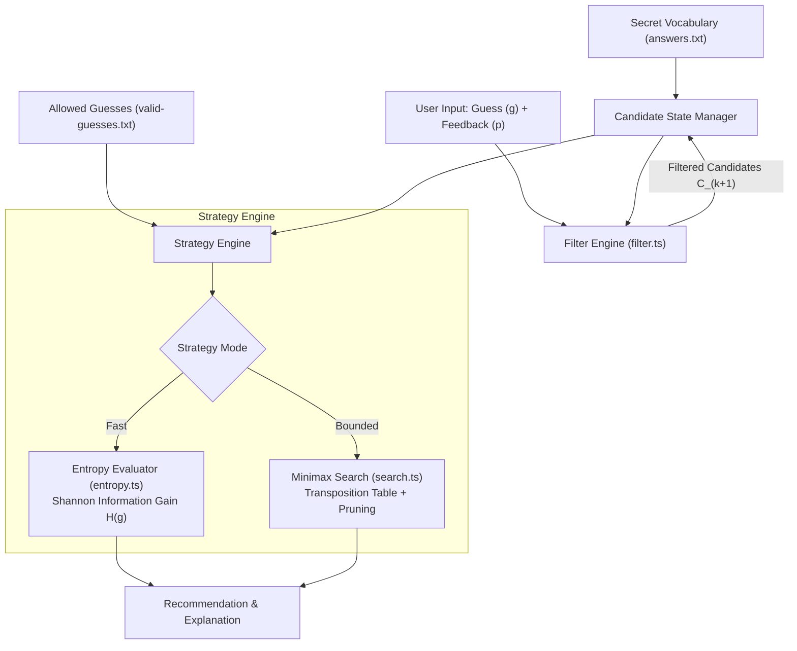
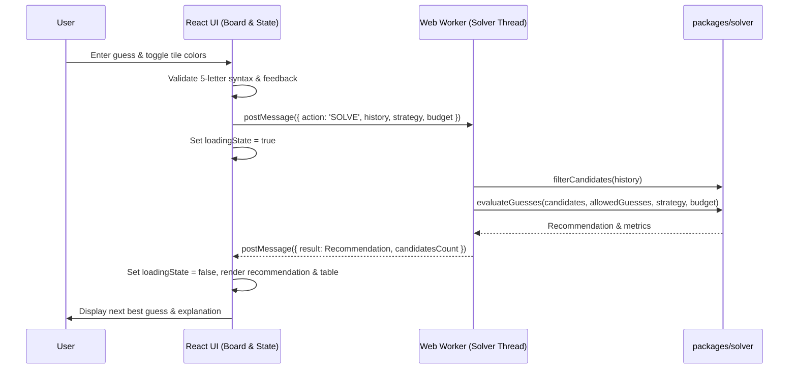

# docs/ARCHITECTURE.md — System Architecture & Component Design

## 1. Monorepo Structural Blueprint

The Wordle Solver is organized as a lightweight, clean TypeScript monorepo using npm/pnpm workspaces. This design guarantees that the mathematical solver engine is completely decoupled from UI frameworks, DOM bindings, and browser extension APIs.

```text
Wordle-Solver/
├── apps/
│   ├── web/                      # Standalone Web Application (React + Vite)
│   │   ├── src/
│   │   │   ├── components/       # Board, Tile, CandidateViewer, StrategySelector
│   │   │   ├── workers/          # Web Worker running solver off-main-thread
│   │   │   ├── hooks/            # useWordleState, useSolverWorker
│   │   │   ├── App.tsx
│   │   │   └── main.tsx
│   │   ├── public/
│   │   ├── index.html
│   │   ├── package.json
│   │   └── vite.config.ts
│   └── extension/                # Chrome Extension Manifest V3
│       ├── manifest.json
│       ├── src/
│       │   ├── content/          # Content script: DOM board observer
│       │   ├── popup/            # Extension popup UI (reuses solver / web views)
│       │   └── background/       # Service worker lifecycle management
│       ├── package.json
│       └── vite.config.ts
├── packages/
│   └── solver/                   # Deterministic Core Engine (Zero UI / Zero DOM)
│       ├── src/
│       │   ├── types.ts          # Domain entities, feedback vectors, statuses
│       │   ├── feedback.ts       # Exact color feedback evaluator
│       │   ├── filter.ts         # Candidate filtering & partition generator
│       │   ├── entropy.ts        # Shannon entropy & expected remaining calculator
│       │   ├── search.ts         # Bounded minimax search with branch pruning
│       │   └── index.ts          # Public solver API
│       ├── package.json
│       └── tsconfig.json
├── data/
│   ├── answers.txt               # Secret target dictionary (candidate set A)
│   └── valid-guesses.txt         # Allowable guess dictionary (guess set G)
├── tests/
│   ├── unit/                     # Unit tests for feedback, filter, entropy
│   ├── search/                   # Minimax, pruning, and guarantee status tests
│   └── small-state/              # Micro-universe exhaustive hand-calculated tests
├── scripts/
│   ├── benchmark.ts              # Comparative evaluation harness (AISC metrics)
│   └── simulate.ts               # End-to-end game simulation runner
├── docs/                         # Specification and architecture documents
├── AGENTS.md
├── PROJECT_INSTRUCTIONS.md
├── README.md
├── package.json                  # Root monorepo workspace configuration
├── tsconfig.base.json            # Shared TypeScript compiler options
└── vitest.config.ts              # Root Vitest test runner configuration
```

---

## 2. Core Domain Data Contracts & Types

The shared package `packages/solver` exposes strictly typed, immutable interfaces:

```typescript
// packages/solver/src/types.ts

/**
 * Tile evaluation states corresponding to Wordle colors:
 * 0 = Grey (Absent or exhausted duplicate)
 * 1 = Yellow (Present elsewhere in target)
 * 2 = Green (Correct position)
 */
export type TileFeedback = 0 | 1 | 2;

/**
 * 5-tuple feedback pattern encoded as a compact array or integer in [0, 242].
 * Example: [2, 0, 1, 0, 0] or compact ternary representation.
 */
export type FeedbackPattern = [TileFeedback, TileFeedback, TileFeedback, TileFeedback, TileFeedback];

/**
 * Turn record representing a played guess and the observed response.
 */
export interface TurnRecord {
  readonly guess: string;
  readonly feedback: FeedbackPattern;
}

/**
 * Status categorization for strategy evaluations.
 */
export type GuaranteeStatus =
  | 'WON'                        // Target found uniquely
  | 'PROVED_WIN'                 // Full tree verified: all candidates solvable in <= k turns
  | 'DISPROVED_WIN'              // Full tree proved: no strategy solves all candidates in <= k turns
  | 'UNRESOLVED_RESOURCE_LIMIT'; // Search bounded by timeout, depth, or node ceiling

/**
 * Strategy identification.
 */
export type StrategyType = 'FAST_ENTROPY' | 'BOUNDED_MINIMAX';

/**
 * Computational resource budget for deeper search operations.
 */
export interface SearchBudget {
  readonly maxDepth: number;           // Maximum search plies (e.g. 2 or 3)
  readonly maxBranchCandidates: number;// Maximum guess candidates to expand per ply
  readonly timeoutMs: number;          // Hard execution time budget (e.g. 500ms)
  readonly maxNodeExpansions: number;  // Safety cap on node expansions
}

/**
 * Guess recommendation with supporting evaluation metrics.
 */
export interface GuessRecommendation {
  readonly guess: string;
  readonly isCandidate: boolean;           // True if guess is in remaining candidate set C
  readonly entropyBits: number;           // Shannon information gain: -sum(p * log2(p))
  readonly expectedRemaining: number;     // Expected candidate set size after guess
  readonly worstCasePartitionSize: number;// Max candidates remaining under worst feedback
  readonly immediateWinProbability: number;// 1/|C| if isCandidate else 0
  readonly distinctPatternsCount: number; // Number of non-empty feedback partitions
  readonly status: GuaranteeStatus;
  readonly explanation: string;           // Concise human-readable rationale
  readonly nodesExpanded?: number;        // For bounded search
  readonly searchDurationMs?: number;     // Runtime measurement
}

/**
 * State of candidate pool and game progress.
 */
export interface SolverState {
  readonly turnNumber: number;
  readonly turnsRemaining: number;
  readonly history: readonly TurnRecord[];
  readonly candidates: readonly string[];
  readonly initialCandidateCount: number;
  readonly isContradiction: boolean;      // True if candidate pool empty (|C| = 0)
}
```

---

## 3. Component Interaction & Data Flows

### 3.1 Core Solver Pipeline



### 3.2 Standalone Web Application Architecture

To maintain 60 FPS UI responsiveness on low-end client machines, all compute-heavy solver calculations (entropy evaluation over 12,972 words $\times |C|$ candidates, or minimax tree search) run inside a **Web Worker**.



### 3.3 Chrome Browser Extension Architecture

```mermaid
flowchart LR
    subgraph Target Web Page
        DOM["Target Game Board DOM"]
    end

    subgraph Chrome Extension (Manifest V3)
        CS["Content Script\n(Observer / Reader)"]
        POP["Popup UI\n(React / Solver View)"]
        SOLV["packages/solver\n(Deterministic Engine)"]
    end

    DOM -.-> |"Extract Board State (Stage 5)"| CS
    CS --> |"chrome.runtime.sendMessage"| POP
    POP --> |"Compute Next Guess"| SOLV
    SOLV --> |"Recommendation"| POP

    POP -.-> |"If DOM invalid or unsupported"| FB["Manual Fallback Grid"]
```

---

## 4. Architectural Boundaries & Security

1. **Client-Side Sandbox:** The entire solver runs purely within the client's browser JS engine or service worker. There are no outbound HTTP requests to external servers, APIs, or trackers.
2. **CSP Compliance:** The Manifest V3 extension avoids `eval()`, `new Function()`, and remote scripts, fully complying with Chrome Extension Content Security Policies.
3. **Graceful Degradation:** If DOM selectors change on the target website, the extension falls back to manual entry mode without crashing.
4. **Main-Thread Protection:** Heavy search trees in the web app are executed in Web Workers to prevent UI freezing.
