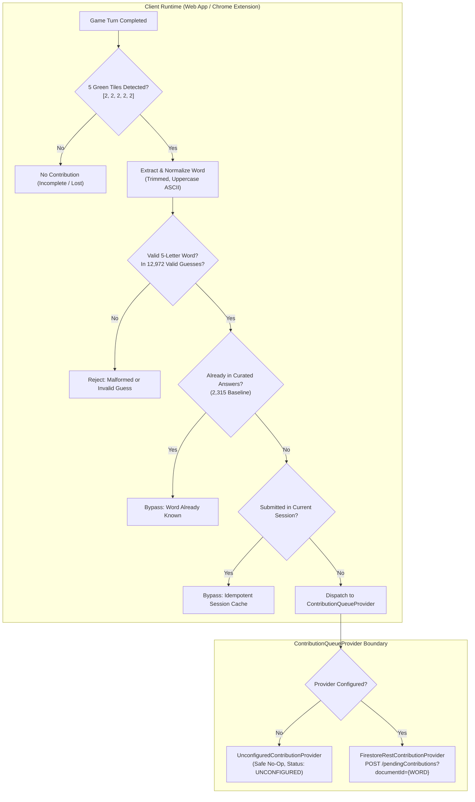
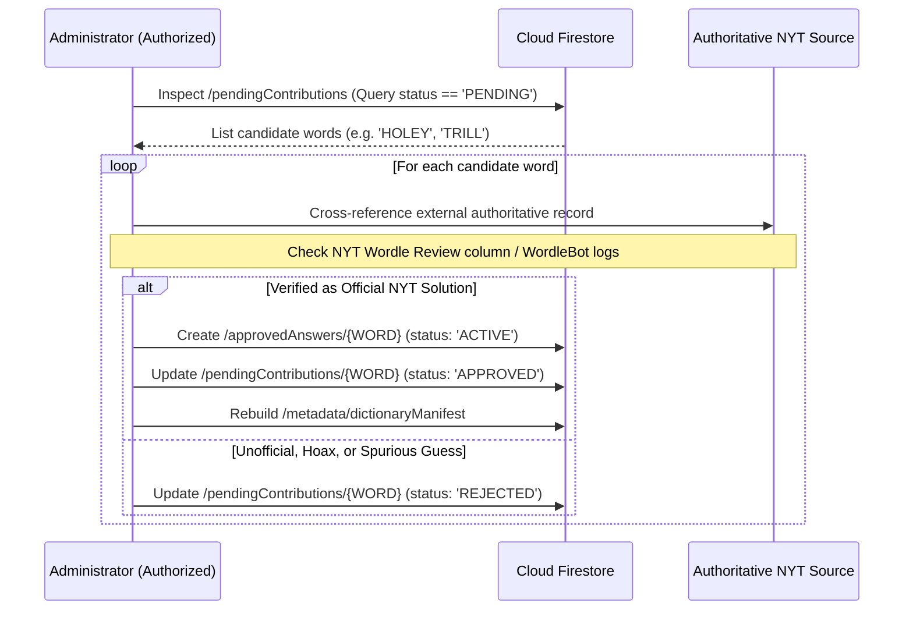

# docs/CONTRIBUTION_PIPELINE.md — Automatic Missing-Answer Contribution & Manual Review Pipeline

**Document Version:** 1.0.0
**Implementation Stage:** Stage 9B
**Target Environment:** Firebase Spark Plan (Zero-Cost / Offline-First)

---

## 1. Executive Summary

This document specifies the architecture, data flow, security model, and manual review protocol for the **Automatic Missing-Answer Contribution Pipeline** introduced in Stage 9B.

### Purpose
When the Wordle Solver encounters a live New York Times (NYT) puzzle whose solution was recently promoted from the accepted guesses dictionary into active rotation (such as `HOLEY` on October 24, 2026, or `TRILL` on October 23, 2026), the application automatically queues a candidate report for administrator review.

### Core Invariants
1. **Quarantine by Default:** All client contributions are stored exclusively in `/pendingContributions/{WORD}` with status `PENDING`. No client submission ever publishes directly to the trusted dictionary.
2. **Local-First Independence:** Solving, candidate filtering, and recommendations operate locally and offline. Network failures, unconfigured Firebase, or cloud outages never disrupt gameplay.
3. **No Personal Data:** Contributions contain only the candidate word, solve turn count (1–6), platform identifier, and client timestamp. Zero IP addresses, user accounts, game histories, or tracking cookies are collected.
4. **Independent Administrator Verification:** A candidate word is never trusted automatically. It must be manually verified against authoritative external records before promotion.

---

## 2. Reusable Pipeline Architecture

Both the web application (`apps/web`) and Chrome extension (`apps/extension`) share the exact same contribution abstraction implemented in [`@wordle-solver/solver`](file:///C:/Users/aksha/OneDrive/Documents/WordleSolver/packages/solver/src/contribution.ts):



### Step-by-Step Execution Lifecycle
1. **Win Detection (`detectWinningWord`):** Inspects the submitted turn records. A win is recognized if and only if any turn contains five green feedback tiles (`[2, 2, 2, 2, 2]`).
2. **Sanitization (`normalizeContributionWord`):** Trims leading/trailing whitespace and normalizes to uppercase ASCII.
3. **Validity & Gap Verification (`isMissingAnswer`):**
   - Word length must be exactly 5 characters.
   - Word must pass `isValidWord()` (alphabetic A–Z).
   - Word must exist in `ALL_VALID_GUESSES` (12,972 allowable words).
   - Word must be **absent** from `INITIAL_ANSWERS` (2,315 curated words).
4. **Session Deduplication:** Tracks submitted words in an in-memory `Set<string>`. Subsequent wins with the same word within a session return `ALREADY_SUBMITTED` without triggering redundant network calls.
5. **Provider Dispatch:** Submits a `PendingContributionPayload` to the configured `ContributionQueueProvider`.

---

## 3. Data Contracts and Schemas

### 3.1 Client Contribution Payload
```typescript
export interface PendingContributionPayload {
  /** 5-letter uppercase ASCII word */
  readonly word: string;
  /** Number of turns taken to win (1-6) */
  readonly solveTurns: number;
  /** Source client environment ('web' | 'extension') */
  readonly clientPlatform: 'web' | 'extension';
  /** Client timestamp in ISO format (informative metadata only) */
  readonly clientTimestamp: string;
}
```

### 3.2 Quarantined Document Schema (`/pendingContributions/{WORD}`)
- **Document Path:** `/pendingContributions/{WORD}`
- **Document ID:** The normalized 5-letter word in uppercase (e.g. `/pendingContributions/HOLEY`).
  > **Idempotency & Create-Only Invariant:** Storing documents by word ID ensures that the first submission creates the quarantined record. Repeated submissions for the same word are safely rejected by Firestore REST with HTTP 409 Conflict (`ALREADY_EXISTS`) or HTTP 412 (`FAILED_PRECONDITION`), preventing duplicate documents, timestamp tampering, or field overwriting.

```json
{
  "word": "HOLEY",
  "solveTurns": 4,
  "clientPlatform": "web",
  "clientTimestamp": "2026-10-24T18:00:00.000Z",
  "status": "PENDING"
}
```

---

## 4. Manual Administrator Review & Independent Verification Protocol

A client-reported win is **not** authoritative proof of an official Wordle solution:
- Users can easily manipulate the DOM via browser DevTools.
- Users can manually set tile colors in the web app to all-green for any arbitrary guess.
- System clocks and network headers can be spoofed.

Therefore, candidate contributions remain strictly quarantined until an administrator executes the **Independent Verification Protocol**.

### Verification Workflow for Administrators



### Reliable Sources for External Verification
Administrators must independently confirm candidate words using one of the following authoritative public records:
1. **The Official NYT Wordle Review Column:** Published daily by Wordle Editor Tracy Bennett on *The New York Times* website (e.g. "Wordle Today: Hints and Answer for [Date]").
2. **Official NYT WordleBot Post-Game Logs:** Accessible after completing the official puzzle on nytimes.com/games/wordle.
3. **Verified Independent Puzzle Archives:** Historical databases recording daily solution words and puzzle sequence numbers (e.g. Wordle Archive, FiveThirtyEight puzzle logs).

---

## 5. Security Capabilities & Limitations on the Firebase Spark Plan

Because Stage 9B operates strictly under the **Firebase Spark Plan** (100% free tier with zero billing or cloud functions), the security boundary is partitioned between client validation, Firestore Security Rules, and server limitations:

### 5.1 What Firestore Security Rules CAN Guarantee
1. **Direct Promotion Prevention:** Rules strictly disallow any client writes to `/approvedAnswers` or `/metadata/dictionaryManifest`. Only authenticated administrators can write to approved collections.
2. **Status Immutability:** Clients can only create documents in `/pendingContributions/{WORD}` if `request.resource.data.status == 'PENDING'`. Clients cannot self-approve words.
3. **Payload Structure Validation:** Rules enforce that `word` is a 5-letter uppercase string (`^[A-Z]{5}$`), `solveTurns` is an integer between 1 and 6, and no unauthorized extra fields are accepted (`request.resource.data.keys().hasOnly(['word', 'solveTurns', 'clientPlatform', 'clientTimestamp', 'status'])`).
4. **Target Isolation & Immutability:** Clients can only create `/pendingContributions/{WORD}` where the document ID matches the `word` field. By enforcing `allow update: if false;`, once a document exists, no client can overwrite fields, forge report counts, or tamper with solve turns.
5. **Privacy Protection:** Public reads on `/pendingContributions` are disabled. Only administrators can read the pending queue.

### 5.2 What Spark Rules CANNOT Guarantee (Documented Limitations)
1. **No IP-Based Rate Limiting:** Firestore Security Rules do not expose client IP addresses and cannot enforce rate limits like "max 5 submissions per IP per hour".
2. **No Wordle Dictionary Lookup:** Firestore Rules cannot cross-reference `data/valid-guesses.txt` without uploading all 12,972 words as Firestore documents. While the client validates this before dispatch, a direct REST API call could bypass client validation.
3. **No Truth Verification:** Rules cannot determine whether NYT actually used a candidate word as that day's answer.
4. **Unauthenticated Write Surface:** Without Firebase Authentication or App Check, any actor with the Firestore REST endpoint could submit syntactically valid 5-letter words to the pending collection.

### 5.3 Audit Assessment Matrix

| Security Property | Enforceable on Spark? | Mechanism & Safeguard | Unresolved Limitation |
| :--- | :--- | :--- | :--- |
| **Write only to Pending** | **YES** | Security rules disallow writes outside `/pendingContributions/{word}` | None |
| **Prevent Self-Approval** | **YES** | Security rules enforce `request.resource.data.status == 'PENDING'` | None |
| **Prevent Data Overwriting** | **YES** | Canonical `createDocument` (POST ?documentId={word}) / PATCH `currentDocument.exists=false` + rules `allow update: if false;` | None |
| **Block Extraneous Fields** | **YES** | `keys().hasOnly([...])` in security rules | None |
| **Consistency: Doc ID == Word** | **YES** | `request.resource.id == request.resource.data.word` | None |
| **Block Public Queue Reads** | **YES** | `allow read: if isAdmin()` (clients cannot inspect pending queue) | None |
| **Dictionary Validation on Server** | **NO** | Client validates before dispatch; server lacks full 12,972-word index | Direct curl attacker could post non-English 5-letter string |
| **IP-Based Anti-Spam / Rate Limit** | **NO** | Client deduplicates in sessionStorage; Firestore rules cannot see IP | Distributed spam requires Cloud Functions / App Check (Blaze) |
| **Ground-Truth NYT Verification** | **NO** | Neither rules nor clients have access to private NYT scheduling | Handled exclusively via manual administrator review protocol |

> [!IMPORTANT] Defense in Depth
> Because rules cannot verify truth or enforce IP rate limits on Spark, **the quarantine layer is the primary security boundary**. Bad or spam submissions accumulate harmlessly in `/pendingContributions` with `status: PENDING` and are ignored until an administrator independently verifies them against authoritative NYT sources.

---

## 6. Offline Fallback & Reliability Verification

- **Default Unconfigured State:** Both `apps/web` and `apps/extension` initialize with `UnconfiguredContributionProvider`. In the absence of a Firebase project configuration, all contribution calls safely return `UNCONFIGURED` without making network requests or logging console errors.
- **Provider Exception Containment:** `MissingAnswerContributionService` wraps all provider invocations in `try/catch` blocks. Network timeouts, HTTP 403/500 errors, or offline drops return clean `FAILED` status objects and are guaranteed never to throw an unhandled promise rejection.
- **Solver Invariant:** The candidate filtering engine, turn history, proved-win lookahead, and recommendation policy run in complete isolation from the contribution service.
