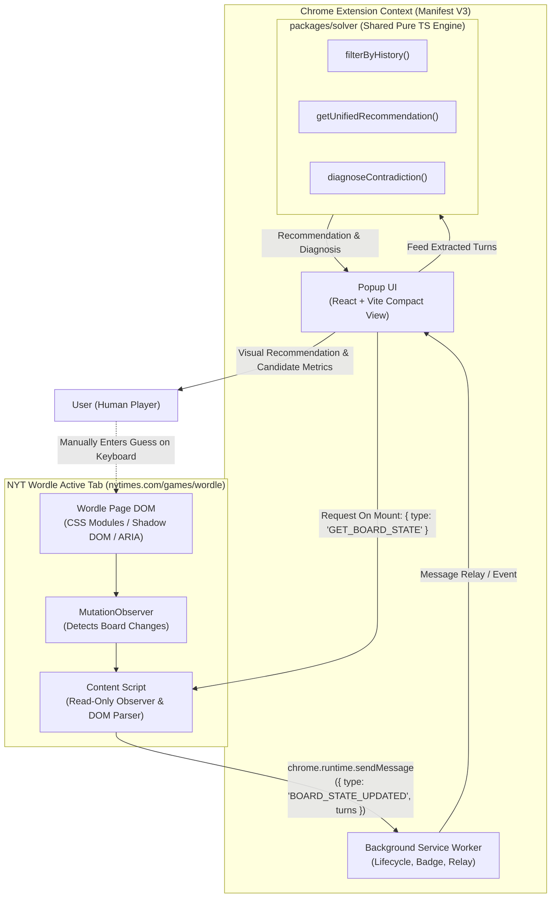
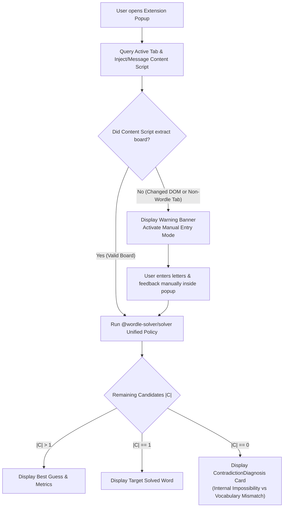

# docs/EXTENSION_PLAN.md — Chrome Extension (Manifest V3) Specification & Architecture Plan

## 1. Executive Summary & Core Objectives

The **Wordle Solver Chrome Extension** brings the verified, deterministic decision support engine developed in `packages/solver` directly into the official New York Times (NYT) Wordle web application.

### Non-Negotiable Operational Principles
1. **Zero Automation / Pure Advisory:** The extension strictly acts as a decision support assistant. It will **never** simulate keyboard inputs, click tiles, or automatically play turns on the user's behalf.
2. **Local-First & Offline:** Zero external API calls, tracking, analytics, backend services, or user accounts. All logic runs client-side.
3. **Engine Reuse:** Consumes the pure TypeScript `@wordle-solver/solver` monorepo package directly, avoiding algorithmic duplication.
4. **Minimal Permissions:** Employs the narrowest necessary permissions (`activeTab`, strictly scoped host permissions to `https://www.nytimes.com/games/wordle*`).
5. **Resilient & Fault-Tolerant DOM Reader:** Treats the NYT Wordle DOM as volatile. Implements a multi-strategy DOM reader with graceful degradation to manual board entry.
6. **Academic Honesty:** Clearly states that the bundled 2,315-word dictionary is the standard benchmark list and makes no false claims of identical synchronization with NYT's proprietary live dictionary.

---

## 2. Architecture & Component Interaction



---

## 3. Extension Directory & Workspace Structure

The extension will reside in `apps/extension` as a standard npm workspace within the repository root:

```text
WordleSolver/
├── apps/
│   ├── web/                           # Standalone Web Application
│   └── extension/                     # Chrome Extension (Manifest V3)
│       ├── manifest.json              # Extension Manifest V3 definition
│       ├── package.json               # Extension workspace dependencies
│       ├── tsconfig.json              # Strict TypeScript configuration
│       ├── vite.config.ts             # Multi-entry build configuration
│       ├── public/
│       │   └── icons/                 # Extension icons (16, 48, 128 px PNG)
│       └── src/
│           ├── background/
│           │   └── service-worker.ts  # Extension lifecycle, badge count, tab relay
│           ├── content/
│           │   ├── dom-reader.ts      # Multi-strategy resilient DOM reader
│           │   ├── observer.ts        # MutationObserver for board change detection
│           │   ├── types.ts           # Content script message contracts
│           │   └── index.ts           # Content script injection entry point
│           ├── popup/
│           │   ├── index.html         # Compact extension popup HTML entry (380x560px)
│           │   ├── main.tsx           # React mounting point
│           │   ├── PopupApp.tsx       # Compact solver view adhering to web UI design
│           │   ├── PopupApp.css       # Compact styling matching dark neutral aesthetic
│           │   ├── hooks/
│           │   │   ├── useActiveTabWordle.ts # Syncs with content script or provides manual fallback
│           │   │   └── useExtensionSolver.ts # Local solver hook utilizing shared engine
│           │   └── components/
│           │       ├── ConnectionBanner.tsx  # "Connected to NYT Wordle" / "Manual Mode"
│           │       ├── CompactBoard.tsx      # Synced 6x5 mini board
│           │       ├── CompactRecommendation.tsx # Current recommended word & metrics
│           │       └── ContradictionCard.tsx # Explanation for empty candidate states
│           └── data/
│               └── words.ts           # Bundled dictionary imports (via ?raw)
└── packages/
    └── solver/                        # Shared deterministic solver engine
```

---

## 4. Manifest V3 Configuration & Permissions

The extension uses the strict minimum permissions necessary:

```json
{
  "manifest_version": 3,
  "name": "Wordle Solver — AISC Decision Support",
  "version": "0.1.0",
  "description": "Deterministic AI decision support and information-gain recommendations for Wordle.",
  "action": {
    "default_popup": "src/popup/index.html",
    "default_title": "Wordle Solver Recommendations",
    "default_icon": {
      "16": "icons/icon-16.png",
      "48": "icons/icon-48.png",
      "128": "icons/icon-128.png"
    }
  },
  "background": {
    "service_worker": "src/background/service-worker.ts",
    "type": "module"
  },
  "content_scripts": [
    {
      "matches": [
        "https://www.nytimes.com/games/wordle*",
        "https://www.nytimes.com/games/wordle/index.html*"
      ],
      "js": ["src/content/index.ts"],
      "run_at": "document_idle"
    }
  ],
  "permissions": [
    "activeTab"
  ],
  "host_permissions": [
    "https://www.nytimes.com/games/wordle*"
  ]
}
```

### Permission Justification & Privacy Guardrails
- **`activeTab`:** Enables temporary access to the active NYT Wordle tab when the user clicks the extension action icon to open the popup.
- **Narrow `host_permissions`:** Restricted strictly to `https://www.nytimes.com/games/wordle*`. Broad patterns (`<all_urls>`, `*://*/*`, `https://*/*`) are strictly forbidden.
- **No Sensitive Permissions:** Does not request `storage` (unless local preferences are added), `cookies`, `webRequest`, `history`, or `tabs`.
- **Zero Telemetry:** No user data, game statistics, or visited URLs are logged, collected, or transmitted.

---

## 5. Technical Specifications: Content Script & DOM Extraction

### 5.1 Verified Facts vs. Assumptions

| Aspect | Status | Technical Details & Assumptions |
| :--- | :--- | :--- |
| **URL Pattern** | **Verified** | Standard game resides at `https://www.nytimes.com/games/wordle` and `https://www.nytimes.com/games/wordle/index.html`. |
| **State Attributes** | **Verified** | Evaluated tiles expose standard `data-state` attributes (`correct`, `present`, `absent`, `tbd`, `empty`). |
| **Letter Storage** | **Verified** | Letters appear as tile text content, or attributes `letter="..."` / `data-letter="..."`. |
| **DOM Hierarchy** | **Assumption** | NYT has deployed both Shadow DOM custom elements (`<game-app>`, `<game-board>`, `<game-row>`, `<game-tile>`) and React CSS modules (`[class*="Board-module"]`, `[class*="Row-module"]`, `[class*="Tile-module"]`). Class hash suffixes change between deployments. |
| **Execution Timing** | **Verified** | Tile flip animations occur sequentially (~250ms per tile, ~1.5s total). Content script must wait until all 5 tiles in a row complete evaluation before extracting a submitted turn. |

### 5.2 Multi-Strategy Resilient DOM Reader

To guard against NYT frontend changes, `dom-reader.ts` implements three sequential parsing strategies:

```typescript
export interface ExtractedTurn {
  readonly guess: string;
  readonly feedback: [TileFeedback, TileFeedback, TileFeedback, TileFeedback, TileFeedback];
  readonly isSubmitted: boolean;
}

export interface BoardExtractionResult {
  readonly success: boolean;
  readonly strategyUsed: 'CSS_MODULES' | 'SHADOW_DOM' | 'SEMANTIC_ARIA' | 'NONE';
  readonly turns: readonly TurnRecord[];
  readonly activeRowIndex: number;
  readonly isRoundComplete: boolean;
  readonly errorMessage?: string;
}
```

#### Strategy A: Modern CSS Modules & State Selectors (Primary)
- Finds board container matching `div[class*="Board-module_board"]` or `div[class*="boardContainer"]`.
- Identifies row containers matching `div[class*="Row-module_row"]`.
- Inspects tile elements matching `div[class*="Tile-module_tile"][data-state]`.

#### Strategy B: Shadow DOM Traversal (Legacy Web Components)
- Accesses `<game-app>`.
- Traverses `.shadowRoot` -> `<game-board>` -> `.shadowRoot` -> `<game-row>` -> `.shadowRoot` -> `<game-tile>`.

#### Strategy C: Semantic ARIA & Grid Fallback
- Searches for `[role="group"]` or `[aria-label*="Row"]` containers.
- Queries children with `aria-label` containing evaluation text (e.g., `"1st letter, C, correct"`).

### 5.3 Distinguishing Submitted Rows from Active / Empty Rows

A row is recognized as **Submitted** if and only if:
1. It contains exactly 5 letter tiles.
2. All 5 tiles have a valid, completed evaluation state:
   - `data-state="correct"` -> TileFeedback `2` (Green)
   - `data-state="present"` -> TileFeedback `1` (Yellow)
   - `data-state="absent"`  -> TileFeedback `0` (Grey)
3. If any tile in the row has `data-state="tbd"` (letters typed but Enter not pressed) or `data-state="empty"`, the row is classified as **Active / Incomplete** and is **excluded** from candidate filtering history.
4. If an animation is ongoing (tiles transitioning), the reader waits for `animationend` or the complete absence of `evaluating` state before extracting.

### 5.4 Repeated Letters & Wordle Evaluation Integrity
- The extension extracts raw tile feedback directly from NYT's visual board.
- The extracted `TurnRecord[]` is passed directly to `@wordle-solver/solver`'s [`filterByHistory()`](file:///C:/Users/aksha/OneDrive/Documents/WordleSolver/packages/solver/src/filter.ts#L138).
- The existing solver feedback evaluator automatically enforces Wordle's exact repeated-letter rules:
  - Green (exact matches) take precedence.
  - Yellow (misplaced letters) consume remaining candidate occurrences left-to-right.
  - Extra occurrences evaluate as Grey (absent).

---

## 6. Real-Time Mutation Observation & Request Lifecycle

### 6.1 DOM Mutation Observer
The content script attaches a `MutationObserver` to the main game container:
- Watches `attributes` (`attributeFilter: ['data-state', 'class', 'letter']`) and `childList`.
- Debounces mutations (200ms) to ensure tile flip animations finish before parsing.
- Dispatches a message to the extension runtime:
  ```typescript
  chrome.runtime.sendMessage({
    type: 'BOARD_STATE_MUTATED',
    payload: extractionResult
  });
  ```

### 6.2 Stale Calculation & Race Condition Prevention
- In the popup UI, every solver execution is tied to a monotonic request counter (`requestIdRef.current++`).
- If the board changes while a deeper search is being computed, the previous computation is superseded.
- As demonstrated in the web app audit, opening recommendations (`SALET`) are pre-computed at module scope, guaranteeing instant startup (<1ms) without blocking the extension popup thread.

---

## 7. Graceful Degradation & Contradiction Handling



1. **DOM Unreadable:**
   If NYT alters their markup and all 3 extraction strategies fail, the popup displays:
   > *"Unable to automatically read the Wordle board. Manual Entry Mode is active."*
   The popup provides an interactive 6×5 board (reusing `useWordleBoard`) allowing the user to type and toggle feedback manually.
2. **Vocabulary Mismatch (`PSHAW` scenario):**
   If the user enters a valid English guess that narrows candidates to 0 within the standard 2,315 answer dictionary (e.g. `PSHAW`), [`diagnoseContradiction()`](file:///C:/Users/aksha/OneDrive/Documents/WordleSolver/packages/solver/src/filter.ts#L182) flags `isVocabularyMismatch: true` and informs the user:
   > *"The recorded feedback eliminates all words in the standard answer list, but matches exist in the comprehensive dictionary ('PSHAW')."*
3. **Internal Logical Contradiction:**
   If feedback markings are contradictory, the popup highlights the earliest turn responsible.

---

## 8. Build, Packaging, and Local Installation

### 8.1 Build Configuration
- Built using Vite with multi-entry points:
  - `popup/index.html` (Popup React application)
  - `content/index.ts` (Content script IIFE / bundle)
  - `background/service-worker.ts` (Service worker ES module)
- Word list data files (`answers.txt`, `valid-guesses.txt`) are bundled into the extension bundle via Vite's `?raw` inlining, requiring zero external file fetching or Node filesystem APIs.
- Build command:
  ```bash
  npm run build --workspace=extension
  ```
- Output directory:
  ```text
  apps/extension/dist/
  ├── manifest.json
  ├── icons/
  ├── src/popup/index.html
  ├── assets/
  │   ├── popup.[hash].js
  │   ├── popup.[hash].css
  │   ├── content.[hash].js
  │   └── service-worker.[hash].js
  ```

### 8.2 Instructions for Loading Unpacked in Chrome
1. Build the extension: `npm run build --workspace=extension`.
2. Open Google Chrome and navigate to `chrome://extensions`.
3. Enable **Developer mode** (toggle in the top-right corner).
4. Click **Load unpacked** in the top-left toolbar.
5. Select the build directory:
   `C:\Users\aksha\OneDrive\Documents\WordleSolver\apps\extension\dist`
6. Navigate to `https://www.nytimes.com/games/wordle` and click the extension icon to view live recommendations.

---

## 9. Verification & Test Strategy

### 9.1 Unit Testing (Vitest)
1. **DOM Reader Fixture Tests:**
   Create synthetic HTML test fixtures representing:
   - Modern NYT CSS modules layout with partially submitted rows.
   - Legacy Shadow DOM layout.
   - Completed winning game board (5 Green tiles).
   - In-progress active row with unsubmitted `tbd` tiles.
   Verify that `dom-reader.ts` extracts identical `TurnRecord[]` structures across all variants.
2. **Repeated Letter Evaluation Test:**
   Verify that rows with repeated letters (e.g. `SPEED` with one yellow and one grey `E`) serialize into expected feedback patterns `[0, 1, 2]`.

### 9.2 Integration Testing
- Mock `chrome.runtime` messaging API to test popup state synchronization when receiving `BOARD_STATE_UPDATED`.
- Test graceful transition to Manual Entry mode when content script sends an error response.
- Comprehensive integration suite in `apps/extension/tests/integration.test.tsx` verifying tab detection, fallback modes, observer updates, race condition prevention, contradiction handling, and solved state detection.
- Live DOM and stylesheet inspection findings documented in [`docs/NYT_LIVE_DOM_AUDIT.md`](file:///C:/Users/aksha/OneDrive/Documents/WordleSolver/docs/NYT_LIVE_DOM_AUDIT.md).

### 9.3 End-to-End Real-Browser Smoke Test
- Host a mock local Wordle page matching NYT DOM structure.
- Load the unpacked extension in headless Chrome via CLI:
  ```bash
  chrome.exe --headless=new --load-extension=apps/extension/dist http://localhost:4173/mock-wordle.html
  ```
- Verify popup loads and computes correct next-guess recommendation.

---

## 10. Technical Risks & Mitigation Strategies

| Risk | Impact | Mitigation Strategy |
| :--- | :--- | :--- |
| **NYT alters CSS class names or DOM structure** | Content script fails to find board elements | Multi-strategy reader (CSS Modules -> Shadow DOM -> ARIA). If all fail, automatically degrade to interactive Manual Entry mode without crashing. |
| **Popup closes when clicking outside** | User loses state if typing manually | Use `chrome.storage.local` or lightweight background memory cache to preserve manual entries across popup toggles. |
| **Heavy search computation in popup freezes UI** | Extension popup feels sluggish or lags | Default to `FAST_ENTROPY` policy (<5ms) and bound deeper minimax search to 300ms limit. Pre-computed opening word `SALET` ensures instant first-render. |
| **Tile flip animation race conditions** | Reading board while tiles are midway through animation reads incomplete feedback | Debounce DOM observer by 200ms; explicitly check that no tiles possess active `evaluating` or `transitioning` attributes. |

---

## 11. Staged Implementation Roadmap

- **Stage 8B:** Extension package setup (`apps/extension`), Manifest V3 definition, and multi-strategy DOM reader unit test fixtures.
- **Stage 8C:** Content script observation engine, background relay, and mock DOM test validation.
- **Stage 8D:** Extension popup React application embedding `@wordle-solver/solver`, manual fallback mode, and visual styling.
- **Stage 8E:** Production build packaging, unpacked Chrome loading verification, and live NYT site smoke testing.
