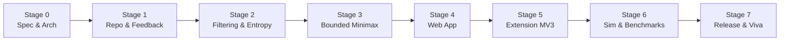

# docs/ROADMAP.md — Staged Implementation Roadmap

## Overview of Development Lifecycle

This project is governed by an **8-stage gated roadmap (Stage 0 to Stage 7)**. Autonomous advancement across stage boundaries is strictly prohibited. Each stage concludes with verified deliverables, passing test suites, and an explicit Stage Completion Report requiring user approval before the next stage begins.

---

## Detailed Stage Specifications

### Stage 0: Specification, Architecture, and Project Governance (CURRENT)
- **Objective:** Establish comprehensive requirements, architecture blueprints, theoretical formulations, testing standards, agent instructions, and implementation roadmap.
- **Deliverables:**
  - `README.md`
  - `AGENTS.md`
  - `PROJECT_INSTRUCTIONS.md`
  - `docs/REQUIREMENTS.md`
  - `docs/ARCHITECTURE.md`
  - `docs/ALGORITHMS.md`
  - `docs/TESTING.md`
  - `docs/ROADMAP.md`
- **Verification:** Workspace isolation confirmed, file paths verified, zero application code written.
- **Exit Gate:** Stage 0 Completion Report presented; user sign-off required to begin Stage 1.

---

### Stage 1: Repository Setup & Tested Feedback Engine
- **Prerequisite:** Explicit user approval of Stage 0.
- **Scope & Objectives:**
  - Initialize Git repository inside `WordleSolver` workspace.
  - Configure monorepo workspaces (`packages/solver`, `apps/web`, `apps/extension`).
  - Configure TypeScript (`tsconfig.json`) in strict mode and Vitest test runner.
  - Verify and import dataset files (`data/answers.txt`, `data/valid-guesses.txt`) with license verification.
  - Implement the core 5-letter feedback engine (`packages/solver/src/feedback.ts`) supporting exact repeated-letter precedence.
- **Verification & Tests:**
  - Vitest test suite executing all edge-case repeated-letter tests (`TC-FB-01` through `TC-FB-08`).
  - Strict TypeScript compilation (`npx tsc --noEmit`) passes with 0 errors.
- **Exit Gate:** All feedback tests pass; git checkpoint committed; user approval required for Stage 2.

---

### Stage 2: Candidate Filtering & Fast Information-Gain Strategy
- **Prerequisite:** Stage 1 sign-off.
- **Scope & Objectives:**
  - Implement candidate filtering engine (`packages/solver/src/filter.ts`).
  - Implement Shannon Entropy calculation and Expected Remaining Candidate scorer (`packages/solver/src/entropy.ts`).
  - Implement recommendation sorting with candidate-preference tie-breaking.
  - Generate clear explanation objects explaining information gain and partition distributions.
- **Verification & Tests:**
  - Filter unit tests verifying monotonic set reduction and contradiction detection (`TC-FILT-01` to `TC-FILT-04`).
  - Unit tests verifying entropy and expected candidate counts on known small distributions.
  - Performance check: entropy calculation over $|C| = 2,309$ completes in $< 50\text{ ms}$.
- **Exit Gate:** Filter and entropy tests pass; git checkpoint committed; user approval required for Stage 3.

---

### Stage 3: Bounded Deeper-Search Strategy with Honest Guarantees
- **Prerequisite:** Stage 2 sign-off.
- **Scope & Objectives:**
  - Implement bounded minimax / game-tree search (`packages/solver/src/search.ts`).
  - Implement branch-and-bound pruning based on worst-case partition sizes.
  - Implement transposition table / memoization keyed by candidate subsets.
  - Integrate hard search budgets: `timeoutMs`, `maxDepth`, `maxNodeExpansions`.
  - Implement the Honest Guarantee reporting status (`WON`, `PROVED_WIN`, `DISPROVED_WIN`, `UNRESOLVED_RESOURCE_LIMIT`).
- **Verification & Tests:**
  - Small-state micro-universe tests verifying `PROVED_WIN` and `DISPROVED_WIN` against hand calculations.
  - Resource limit tests (`TC-GUAR-01`, `TC-GUAR-02`) proving timeouts result in `UNRESOLVED_RESOURCE_LIMIT` and never false proofs.
- **Exit Gate:** Search and guarantee tests pass; git checkpoint committed; user approval required for Stage 4.

---

### Stage 4: Standalone Web Application
- **Prerequisite:** Stage 3 sign-off.
- **Scope & Objectives:**
  - Build responsive React + Vite web application (`apps/web`).
  - Implement interactive 5-letter board with keyboard input and click-to-cycle tile color toggling.
  - Implement candidate list display with live count and candidate filter viewer.
  - Implement strategy toggle (Fast Entropy vs Bounded Minimax).
  - Offload search computation to a Web Worker to keep UI smooth and responsive.
  - Provide distinct alert banners for contradiction states and search limit warnings.
- **Verification & Tests:**
  - Component tests for board rendering, tile color toggles, and worker messaging.
  - Manual UI verification in browser (offline functionality, responsive mobile layout).
- **Exit Gate:** Web app functions smoothly end-to-end; git checkpoint committed; user approval required for Stage 5.

---

### Stage 5: Chrome Browser Extension (Manifest V3)
- **Prerequisite:** Stage 4 sign-off.
- **Scope & Objectives:**
  - Build Chrome Extension Manifest V3 (`apps/extension`).
  - Inspect target Wordle website DOM structure and implement robust DOM reader content script.
  - Implement popup UI embedding the solver engine.
  - Implement seamless fallback to manual board entry if DOM extraction fails or page is unsupported.
  - Package extension as an unpacked directory and zip archive.
- **Verification & Tests:**
  - Load unpacked extension in Chrome Developer Mode (`chrome://extensions`).
  - Verify live board reading on target site and verify manual fallback mode.
  - Validate minimal permissions in `manifest.json`.
- **Exit Gate:** Extension verified in Chrome; git checkpoint committed; user approval required for Stage 6.

---

### Stage 6: Simulation Harness & Comparative Evaluation
- **Prerequisite:** Stage 5 sign-off.
- **Scope & Objectives:**
  - Implement simulation scripts (`scripts/simulate.ts` and `scripts/benchmark.ts`).
  - Run reproducible comparative benchmarks between Fast Entropy and Bounded Minimax across fixed test suites.
  - Collect empirical metrics: solve rate ($\le 6$ guesses), average guesses, worst-case guesses, runtime latency, and node expansions.
  - Generate formatted Markdown evaluation tables for AISC report inclusion.
- **Verification & Tests:**
  - Verify seed-based reproducibility of benchmark runs.
  - Ensure zero fabricated numbers; all metrics generated directly from simulation output.
- **Exit Gate:** Benchmark data generated and documented; git checkpoint committed; user approval required for Stage 7.

---

### Stage 7: Release Packaging, Documentation & Viva Preparation
- **Prerequisite:** Stage 6 sign-off.
- **Scope & Objectives:**
  - Finalize top-level `README.md` with complete installation guides, screenshots, and AISC project summary.
  - Produce GitHub Release bundle containing extension ZIP and web app static build.
  - Prepare academic defense document (`docs/VIVA_PREPARATION.md`) with theoretical derivations, complexity analysis, and answers to likely examiner questions.
  - Optional static deployment to Cloudflare Pages / GitHub Pages.
- **Verification & Tests:**
  - Clean build of all packages (`npm run build`).
  - Complete test suite pass across all workspaces.
- **Exit Gate:** Project finalized, fully documented, and ready for presentation and defense.
