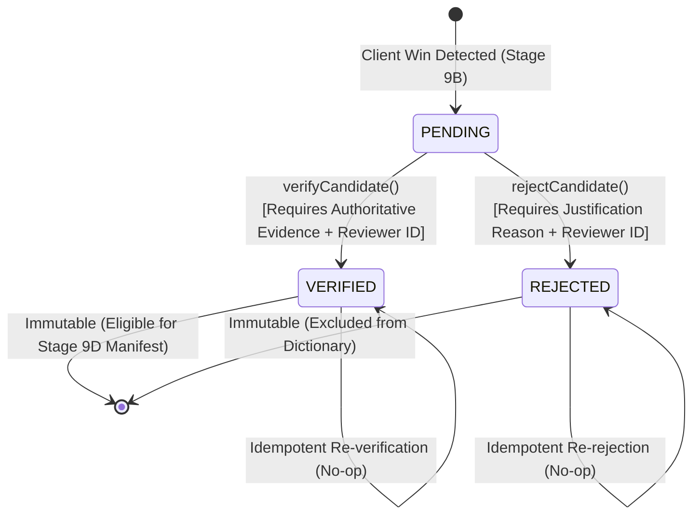
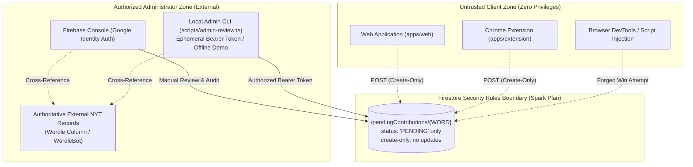

# docs/STAGE_9C_ADMIN_REVIEW.md — Manual Administrator Review Workflow

**Document Version:** 1.0.0
**Implementation Stage:** Stage 9C
**Target Environment:** Firebase Spark Plan (Zero-Cost / Offline-First)

---

## 1. Executive Summary

This document specifies the architectural model, trust boundaries, state machine, and administrator procedures for reviewing quarantined missing-answer contributions in **Wordle Solver** (Stage 9C).

In Stage 9B, an automatic contribution pipeline was established that detects when a puzzle is won with a word missing from the primary curated dictionary (`data/answers.txt`) and safely queues it into a quarantined staging collection (`/pendingContributions/{WORD}`).

**Stage 9C introduces the authoritative review workflow:** a missing candidate word is **never** automatically promoted into the trusted dictionary. It must undergo independent, human-verified administrative review against authoritative New York Times (NYT) records before it is eligible for community distribution in Stage 9D.

---

## 2. Review Lifecycle & State Machine

The review lifecycle consists of three explicit states:

1. **`PENDING`:** Initial quarantined state. The candidate word has been reported by one or more client win detections, but has zero authoritative standing.
2. **`VERIFIED`:** An authorized administrator has independently confirmed via official NYT publication records that this word was used as an official daily solution.
3. **`REJECTED`:** An administrator has evaluated the candidate and determined it is not an official solution (e.g., test submission, browser DevTools tampering, acceptable valid guess not yet in active answer rotation).



### 2.1 State Transition Rules

| Initial State | Target State | Permitted? | Required Preconditions | Behavior / Result |
| :--- | :--- | :---: | :--- | :--- |
| `PENDING` | `VERIFIED` | **YES** | 1. 5-letter uppercase ASCII word<br/>2. Authenticated `reviewerId`<br/>3. Authoritative `evidence.source` (URL/citation)<br/>4. Word present in 12,972 valid guesses | Transitions to `VERIFIED`; stores `ReviewRecord`; clears pending entry |
| `PENDING` | `REJECTED` | **YES** | 1. 5-letter uppercase ASCII word<br/>2. Authenticated `reviewerId`<br/>3. Non-empty `rejectionReason` ($\ge 3$ chars) | Transitions to `REJECTED`; stores `ReviewRecord`; clears pending entry |
| `VERIFIED` | `VERIFIED` | **YES** | None | Idempotent return (`ALREADY_VERIFIED`); preserves original audit timestamp |
| `REJECTED` | `REJECTED` | **YES** | None | Idempotent return (`ALREADY_REJECTED`); preserves original audit timestamp |
| `VERIFIED` | `REJECTED` | **NO** | N/A | Rejected with `INVALID_TRANSITION`; verified solutions are immutable |
| `REJECTED` | `VERIFIED` | **NO** | N/A | Rejected with `INVALID_TRANSITION`; requires explicit admin override |

---

## 3. The Trust Boundary & Threat Model



### 3.1 Why Client-Reported Wins and Repeated Submissions Are NOT Proof

Under no circumstances may client-side reports be treated as truth:
1. **Client DOM Manipulation:** Any user can open Chrome DevTools and mutate the DOM feedback tiles to green (`class="correct"`), triggering a false win detection.
2. **Web Color Toggles:** In `apps/web`, a user can manually cycle feedback tiles to green for any word in the dictionary.
3. **Sybil & Scripted Spam:** A single script or botnet could generate 10,000 requests for an arbitrary allowable guess (e.g. `XYLYL`). Volume of reports does **not** correlate with editorial selection.
4. **Valid Guess $\ne$ Solution:** Wordle recognizes ~12,972 valid English words, but only ~2,315 are in curated active rotation. A word being accepted by the game board is never proof of being a puzzle solution.

**Invariant:** Only independent human verification against external editorial records constitutes valid evidence for dictionary promotion.

---

## 4. Chosen Administrator Workflows

Because the project operates under the **Firebase Spark Plan** (100% free tier with zero billing or cloud functions), administrative actions must not depend on complex backend servers or compromise security.

Two safe workflows are provided:

### Workflow A: Native Firebase Console Manual Review (Primary / Zero Risk)
1. The administrator visits `https://console.firebase.google.com/`.
2. Authenticates using their Google account assigned the least-privilege **Cloud Datastore User** (`roles/datastore.user`) IAM role. Broad Project Owner or Editor access is explicitly discouraged.
3. Opens **Firestore Database** -> **`pendingContributions`** collection.
4. Reads candidate words (e.g., `HOLEY`, `TRILL`).
5. Cross-references the candidate against authoritative NYT sources (see Section 4.3).
6. If verified, updates document or creates corresponding `/approvedAnswers/{WORD}` entry.
7. If invalid, deletes or marks document `status: "REJECTED"`.

*Advantages:* Zero secret management, multi-factor authentication handled natively by Google, least-privilege IAM scoping, impossible for browser clients to compromise.

### Workflow B: Local Administrator CLI (`scripts/admin-review.ts`)
For scripted or batch administrative tasks:
```bash
# Set ephemeral admin credentials from Google Cloud CLI (never committed to git)
export FIREBASE_PROJECT_ID="your-project-id"
export FIREBASE_ADMIN_TOKEN="$(gcloud auth print-access-token)"

# List pending candidate contributions
npx tsx scripts/admin-review.ts list

# Inspect candidate history
npx tsx scripts/admin-review.ts inspect HOLEY

# Verify an official answer with mandatory evidence reference
npx tsx scripts/admin-review.ts verify HOLEY \
  --source "https://www.nytimes.com/2026/10/24/crosswords/wordle-review-1588.html" \
  --puzzle 1588 \
  --date 2026-10-24 \
  --notes "Official NYT Wordle solution #1588."

# Reject a spurious candidate with mandatory justification
npx tsx scripts/admin-review.ts reject FOOBAR \
  --reason "Not an active Wordle solution; spurious test submission."

# Run offline dry-run demonstration without credentials:
npx tsx scripts/admin-review.ts --demo list
```

### 4.2 Credential Handling & Least-Privilege IAM Invariants
- **No Embedded Credentials:** Service account JSON files, private keys, or API tokens must **NEVER** be committed to Git, bundled into Vite build outputs, or stored in client-side environment variables.
- **Least-Privilege IAM Role:** Administrators must be granted strictly `roles/datastore.user` (Cloud Datastore User). Authoritative Google Cloud IAM documentation verifies this role grants data plane entity access (`datastore.entities.get`, `datastore.entities.list`, `datastore.entities.create`, `datastore.entities.update`, `datastore.entities.delete`), while strictly excluding administrative database creation/deletion (`datastore.databases.create/delete`) and data export/import capabilities. Broad Project Owner or Editor access is explicitly unnecessary and prohibited.
- **Fail-Closed Safety:** If `FIREBASE_ADMIN_TOKEN` is unset, `scripts/admin-review.ts` and `FirestoreRestAdminReviewProvider` safely halt with `UNCONFIGURED` without making network calls. All unauthenticated or forbidden requests (HTTP 401/403) fail closed with explicit diagnostic messages.
- **Process Table Protection & Deprecation:** Ephemeral tokens must be passed via the `FIREBASE_ADMIN_TOKEN` environment variable. The `--token` CLI flag is explicitly **deprecated and insecure** because command-line flags leak into operating system process tables (`ps aux`, WMI queries) and shell history files (`~/.bash_history`).
- **Token Redaction:** The provider sanitizes error messages and response texts to ensure bearer tokens are never leaked in error logs or thrown exceptions, while fully preserving HTTP status codes and diagnostic error context.
- **No Client Dashboard:** There is no "admin page" in `apps/web` protected by client-side passwords. All administrative logic exists outside client bundles.

### 4.3 Authoritative External Verification Sources
Administrators must cross-reference at least one of the following authoritative records before executing `verifyCandidate`:
1. **The Official NYT Wordle Review Column:** Published daily by Wordle Editor Tracy Bennett on *The New York Times* website.
2. **Official NYT WordleBot Post-Game Logs:** Accessible on nytimes.com/games/wordle after puzzle completion.
3. **Independent Archival Records:** Respected public Wordle archives tracking daily puzzle numbers and solutions.

### 4.4 Authentication vs. Audit Label Distinction
- **Reviewer Identifier (`reviewerId`):** A human-readable operator label (e.g. `admin_sarah` or CLI username) stored for audit trail records. **The `reviewerId` is strictly an audit label and does NOT authenticate the caller.**
- **Real Authorization:** Authorization is enforced exclusively at the transport/IAM boundary. The Google Cloud OAuth2 access token (`FIREBASE_ADMIN_TOKEN`) is validated by Google Cloud IAM against the project's access control policies. If the token is expired, invalid, or lacks `roles/datastore.user`, Firestore rejects the request with HTTP 401 Unauthorized or HTTP 403 Permission Denied.

---

## 5. Review Record & Audit Trail Schema

When a candidate word is reviewed, an immutable audit record is recorded:

```typescript
export interface ReviewRecord {
  /** 5-letter uppercase ASCII word */
  readonly word: string;
  /** Resulting review status */
  readonly status: 'VERIFIED' | 'REJECTED';
  /** Timestamp when the review action occurred (ISO 8601) */
  readonly reviewedAt: string;
  /** Informative audit trail label identifying the operator */
  readonly reviewerId: string;
  /** Mandatory evidence reference when status is VERIFIED */
  readonly evidence?: {
    readonly source: string;
    readonly puzzleNumber?: number;
    readonly publicationDate?: string;
    readonly notes?: string;
  };
  /** Mandatory rejection note / reason when status is REJECTED */
  readonly rejectionReason?: string;
  /** Server document version timestamp for optimistic concurrency control */
  readonly updateTime?: string;
}
```

### 5.1 Zero-PII Guarantee
The audit record contains zero personal identifiers, user IP addresses, browser user agents, or game histories. Only the verified word and editorial metadata are preserved.

### 5.2 Firestore REST Concurrency & Precondition Guarantees
Under concurrent administrative review (e.g. two operators reviewing the same word simultaneously):
1. **Optimistic Preconditions:**
   - **Initial Review:** Uses `currentDocument.exists=false`. If a concurrent write created a review record first, Firestore engine rejects with HTTP 412 Precondition Failed or HTTP 409 Conflict.
   - **Update Review:** Uses `currentDocument.updateTime=${updateTime}`. The timestamp is strictly validated as an RFC 3339 UTC timestamp (`isValidRfc3339Timestamp`). If a record exists but its timestamp is missing or malformed, the provider **fails closed** immediately and refuses to issue an unconstrained update.
2. **Field Isolation via UpdateMask:**
   - Review operations send repeated `updateMask.fieldPaths` query parameters for only modified fields (`word`, `status`, `reviewedAt`, `reviewerId`, `evidenceSource`, etc.). Unrelated document fields are never overwritten or erased.
3. **Terminal State Immutability Under Race Conditions:**
   - When HTTP 412/409 occurs, `FirestoreRestAdminReviewProvider` re-fetches the latest document version. If the concurrent write established a terminal state (`VERIFIED` or `REJECTED`), contradictory changes are rejected with `INVALID_TRANSITION`, and identical states return idempotent success (`ALREADY_VERIFIED` or `ALREADY_REJECTED`). Terminal statuses can never be switched or corrupted. Unsafe mutations are never retried.
The audit record contains zero personal identifiers, user IP addresses, browser user agents, or game histories. Only the verified word and editorial metadata are preserved.

---

## 6. Spark Plan Budget Compatibility

| Operation | Spark Free Quota | Admin Review Consumption | Headroom |
| :--- | :--- | :--- | :--- |
| **Document Reads** | 50,000 / day | ~5–20 / review session | >99.9% unused |
| **Document Writes** | 20,000 / day | ~1–5 / approved word | >99.9% unused |
| **Stored Data** | 1 GiB total | ~500 bytes / candidate | >99.9% unused |

All operations fit comfortably within the zero-cost Firebase Spark plan limits.

---

## 7. Roadmap Boundary: Implemented vs. Deferred

- **Stage 9B (Completed & Pushed):** Automatic client-side detection and quarantined submission to `/pendingContributions/{WORD}`.
- **Stage 9C (Current):** Authoritative review lifecycle, transition validation, terminal state immutability, `AdminReviewService`, `scripts/admin-review.ts` CLI, and regression tests.
- **Stage 9D (Deferred to Next Stage):** Aggregated dictionary manifest generation (`/metadata/dictionaryManifest`), client-side polling, and local cache synchronization.
