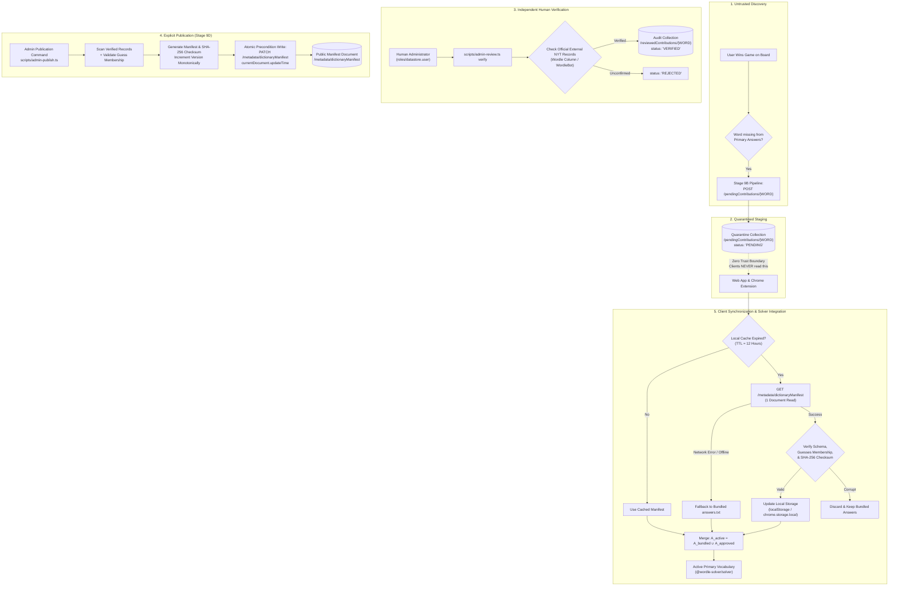

# docs/STAGE_9D_TRUSTED_DICTIONARY_PLAN.md — Stage 9D Trusted Dictionary Integration Plan

**Document Version:** 1.0.0<br/>
**Implementation Stage:** Stage 9D (Planning Phase)<br/>
**Target Repository:** `WordleSolver` (`https://github.com/AkshatVarma14/WordleSolver.git`)<br/>
**Workspace Root:** `C:\Users\aksha\OneDrive\Documents\WordleSolver`<br/>
**Base Commit:** [`a06dc2bc23dca9d6a627f2b1d702e15cf323761f`](https://github.com/AkshatVarma14/WordleSolver/commit/a06dc2bc23dca9d6a627f2b1d702e15cf323761f) (`feat: add manual admin review workflow`)<br/>
**Target Environment:** Firebase Spark Plan (100% Zero-Cost / Offline-First)

---

## 1. Executive Summary & Problem Definition

The **Wordle Solver** project currently has:
1. A deterministic, information-theoretic solving engine (`@wordle-solver/solver`) using Shannon entropy, minimax lookahead search, and layered candidate filtering.
2. A bundled, static dictionary baseline:
   - Primary curated answers: **2,315 words** (`data/answers.txt`).
   - Allowed valid guesses: **12,972 words** (`data/valid-guesses.txt`).
3. An automatic missing-answer contribution pipeline (Stage 9B) that detects when a puzzle is won with a word missing from `answers.txt` and stages it in a quarantined queue (`/pendingContributions/{WORD}`).
4. A secure, manual administrative review workflow (Stage 9C) with an authorized CLI (`scripts/admin-review.ts`) that enforces independent external evidence verification and records immutable audit records in `/reviewedContributions/{WORD}`.

### The Missing Link (Stage 9D)
A review record marked `VERIFIED` in `/reviewedContributions` currently lives in isolation as an audit log. The solver in `apps/web` and `apps/extension` still compiles against the static 2,315-word bundled list. When an official New York Times puzzle features a newly introduced solution (such as `HOLEY` or `TRILL`), the solver treats it as missing and falls back to unverified expanded guesses (`EXPANDED_FALLBACK`), warning the user that the word is unverified.

**Stage 9D Objective:** Safely and efficiently integrate human-verified, approved answers into the solver's active primary dictionary across both the web application and Chrome extension, while preserving:
- Strict local-first architecture and instant offline startup.
- Complete independence from unverified client inputs.
- Zero-cost operation under the Firebase Spark plan.
- Mathematical solver integrity (verified words become first-class primary answer candidates).

---

## 2. Current Architecture Baseline

An inspection of the workspace at commit `a06dc2b` established the following implementation details:

### 2.1 Dictionary Loading & Bundling
- In [`apps/web/src/data/words.ts`](file:///C:/Users/aksha/OneDrive/Documents/WordleSolver/apps/web/src/data/words.ts) and [`apps/extension/src/data/words.ts`](file:///C:/Users/aksha/OneDrive/Documents/WordleSolver/apps/extension/src/data/words.ts):
  - Dictionaries are bundled at build time via Vite's raw text import:
    ```typescript
    import answersRaw from '../../../../data/answers.txt?raw';
    import validGuessesRaw from '../../../../data/valid-guesses.txt?raw';

    export const INITIAL_ANSWERS: readonly string[] = Object.freeze(
      answersRaw.trim().split(/\r?\n/).map((w) => w.trim().toUpperCase()).filter(Boolean)
    );
    export const ALL_VALID_GUESSES: readonly string[] = Object.freeze(
      validGuessesRaw.trim().split(/\r?\n/).map((w) => w.trim().toUpperCase()).filter(Boolean)
    );
    ```
  - Both web and extension run with zero initial network overhead ($<1\text{ms}$ dictionary load).

### 2.2 Solver Engine Consumption
- In [`packages/solver/src/filter.ts`](file:///C:/Users/aksha/OneDrive/Documents/WordleSolver/packages/solver/src/filter.ts#L251-L332):
  - `filterByLayeredHistory(primaryAnswers, expandedGuesses, history)` filters first against `primaryAnswers`.
  - If candidates remain, `scope === 'PRIMARY'`.
  - If zero candidates remain, it filters `expandedGuesses` and sets `isExpandedFallback === true` (`scope === 'EXPANDED_FALLBACK'`).
- In [`apps/web/src/worker/solver.worker.ts`](file:///C:/Users/aksha/OneDrive/Documents/WordleSolver/apps/web/src/worker/solver.worker.ts):
  - Solving runs off the main thread in a dedicated Web Worker.
  - The worker imports `INITIAL_ANSWERS` statically from `../data/words`.
- In [`apps/extension/src/popup/PopupApp.tsx`](file:///C:/Users/aksha/OneDrive/Documents/WordleSolver/apps/extension/src/popup/PopupApp.tsx#L140-L172):
  - The popup solver runs synchronously in a React `useMemo` using `INITIAL_ANSWERS`.

### 2.3 Existing Contribution and Review States
- **Stage 9B:** [`MissingAnswerContributionService`](file:///C:/Users/aksha/OneDrive/Documents/WordleSolver/packages/solver/src/contribution.ts#L368) submits winning turns missing from `INITIAL_ANSWERS` to `/pendingContributions/{WORD}` with fields:
  `{ word, solveTurns, clientPlatform, clientTimestamp }`.
- **Stage 9C:** [`AdminReviewService`](file:///C:/Users/aksha/OneDrive/Documents/WordleSolver/packages/solver/src/review.ts#L882) and [`FirestoreRestAdminReviewProvider`](file:///C:/Users/aksha/OneDrive/Documents/WordleSolver/packages/solver/src/review.ts#L380) record review decisions in `/reviewedContributions/{WORD}` with schema:
  `{ word, status: 'VERIFIED' | 'REJECTED', reviewedAt, reviewerId, evidence, updateTime }`.
- Concurrency in Stage 9C is strictly guarded with Firestore REST preconditions (`currentDocument.exists=false` and `currentDocument.updateTime=${RFC3339}`).

---

## 3. The Trust Boundary & 5-Stage Lifecycle



### Core Trust Invariants
1. **No Automatic Promotion:** A discovered word is never promoted merely because a user won a game or 10,000 bots submitted reports.
2. **Review Record Separation:** An audit document with `status: 'VERIFIED'` records a human approval decision, but is **not** direct dictionary distribution. Publication must be an explicit, auditable administrative act.
3. **Double Verification:** Every word in the published manifest must independently satisfy:
   - Presence in `ALL_VALID_GUESSES` (12,972 words).
   - Valid 5-letter uppercase ASCII format.
   - Traceable verification evidence.
4. **Client-Side Defense-in-Depth:** Even if the remote database is tampered with or corrupted, clients validate every word against the client's own bundled `ALL_VALID_GUESSES` and verify the SHA-256 checksum before merging.
5. **Fail-Closed Offline Fallback:** If synchronization encounters network failure, timeout, invalid JSON, or authorization denial, clients run seamlessly using bundled `data/answers.txt`.

---

## 4. Architectural Alternatives Considered

| Dimension | Alternative A: Direct Document Query | Alternative B: Cloud Function Trigger | Alternative C: Static CDN / GitHub Release | Alternative D: Versioned Aggregated Manifest (RECOMMENDED) |
|---|---|---|---|---|
| **Mechanism** | Clients query `/approvedAnswers` collection directly. | Firestore `onWrite` triggers Cloud Function to compile manifest. | Git commit pushed to repo; GitHub Actions deploys static JSON. | Admin CLI publishes aggregated document to `/metadata/dictionaryManifest`. |
| **Spark Plan Feasibility** | **FAIL.** 1,000 users reading 50 words = 50,000 reads/day (exhausts free quota). | **FAIL.** Cloud Functions require the **Firebase Blaze plan** (billing/credit card). | **PASS.** Free, but requires CI/CD runner and full deployment cycle per word. | **PASS.** 1,000 users = 2,000 reads/day ($<4\%$ of Spark daily quota). |
| **Latency / Update Speed** | Real-time. | Real-time. | High latency (minutes to hours). | Immediate on admin publish. |
| **Client Complexity** | Complex pagination and indexing. | Simple single-document fetch. | Simple single-file fetch. | Simple single-document fetch with local cache. |
| **Offline Resilience** | Poor without heavy cache layer. | Strong with local cache. | Strong with local cache. | Strong with local cache. |
| **Operational Overhead** | None. | High (runtime deployment, billing config). | High (Git repository churn for data updates). | Low (CLI command runs on admin machine). |

### Selected Architecture: Alternative D (Aggregated Manifest)
- Keeps the project **100% free with zero cloud functions or billing**.
- Consumes **exactly 1 Firestore document read** per client per 12-hour sync window.
- Provides atomic, versioned, checksum-verified distribution.

---

## 5. Schema Specifications

### 5.1 Remote Manifest Schema (`/metadata/dictionaryManifest`)
Stored as a single Firestore document at path `/metadata/dictionaryManifest`:

```typescript
export interface DictionaryManifestDocument {
  /** Monotonically increasing dataset version number (e.g. 1, 2, 3...) */
  readonly version: number;
  /** ISO 8601 UTC timestamp when this manifest was published */
  readonly publishedAt: string;
  /** Human-readable operator audit label (e.g. "admin_sarah" or CLI user) */
  readonly publishedBy: string;
  /** Total count of approved words in this manifest */
  readonly wordCount: number;
  /** Lexicographically sorted array of 5-letter uppercase ASCII approved words */
  readonly words: readonly string[];
  /** SHA-256 hexadecimal digest of JSON.stringify(words) */
  readonly checksum: string;
  /** Optional editorial release notes */
  readonly releaseNotes?: string;
}
```

*Example Firestore Document Representation:*
```json
{
  "fields": {
    "version": { "integerValue": "3" },
    "publishedAt": { "stringValue": "2026-10-26T14:00:00.000Z" },
    "publishedBy": { "stringValue": "admin-cli" },
    "wordCount": { "integerValue": "5" },
    "words": {
      "arrayValue": {
        "values": [
          { "stringValue": "GUANO" },
          { "stringValue": "HOLEY" },
          { "stringValue": "PSHAW" },
          { "stringValue": "SNAFU" },
          { "stringValue": "TRILL" }
        ]
      }
    },
    "checksum": { "stringValue": "b8a9561f5c35b67489ab8c92a95c9b139049e917d2d3a39e80a06802e9647249" },
    "releaseNotes": { "stringValue": "Added HOLEY (#1588) and TRILL (#1590)" }
  }
}
```

### 5.2 Client Local Cache Schema
Stored in client persistent storage (`localStorage` in web, `chrome.storage.local` in extension):

- **Storage Key:** `wordle_solver_dictionary_manifest_v1`
- **Schema:**
```typescript
export interface CachedDictionaryManifest {
  readonly manifest: DictionaryManifestDocument;
  /** Local client epoch timestamp when the manifest was retrieved */
  readonly cachedAt: number;
  /** Schema version of the cache container */
  readonly schemaVersion: 1;
}
```

---

## 6. Security, Authorization & Concurrency Model

### 6.1 Firestore Security Rules (Target Deployment Specification)
```javascript
rules_version = '2';
service cloud.firestore {
  match /databases/{database}/documents {

    // Helper: Validates 5-letter uppercase ASCII string
    function isValidWord(word) {
      return word is string && word.size() == 5 && word.matches('^[A-Z]{5}$');
    }

    // 1. Dictionary Manifest: Publicly readable; strictly read-only for clients
    match /metadata/dictionaryManifest {
      allow read: if true;
      allow write: if false; // Mutated exclusively via Google Cloud IAM OAuth tokens
    }

    // 2. Approved Answers Archive: Publicly readable; strictly read-only for clients
    match /approvedAnswers/{word} {
      allow read: if true;
      allow write: if false;
    }

    // 3. Quarantined Contribution Submissions (Stage 9B)
    match /pendingContributions/{word} {
      allow read: if false; // Private queue; reviewed via IAM admin tokens
      allow create: if isValidWord(word)
        && request.resource.data.word == word
        && request.resource.data.solveTurns >= 1
        && request.resource.data.solveTurns <= 6;
      allow update, delete: if false;
    }

    // 4. Administrator Review Records (Stage 9C)
    match /reviewedContributions/{word} {
      allow read, write: if false; // Managed exclusively via IAM admin tokens
    }
  }
}
```

### 6.2 Administrator Publication Boundary
- Publication writes are executed via `scripts/admin-publish.ts`.
- Uses Google Cloud OAuth2 bearer token with `roles/datastore.user` (least privilege).
- **Optimistic Concurrency Control:**
  - Reads existing manifest document and its `updateTime`.
  - Publishes updated manifest via `PATCH /metadata/dictionaryManifest?currentDocument.updateTime=${updateTime}`.
  - If another administrator published concurrently, the request fails with HTTP 412 (Precondition Failed), preventing silent overwrites.

### 6.3 Client-Side Integrity & Poisoning Defenses
When a client downloads `/metadata/dictionaryManifest`:
1. **Schema Check:** Verifies `version` is positive integer, `words` is an array of strings, `checksum` is 64-char hex string.
2. **Version Monotonicity:** Verifies `downloaded.version >= cached.version`. Discards stale responses.
3. **Lexical Filtering:** Validates each word:
   - Must be 5 uppercase ASCII letters.
   - **Must be contained in the client's bundled `ALL_VALID_GUESSES`.** If an adversary compromised Firestore and added `XXXXX` or an offensive/corrupted string not in the official 12,972 valid guess list, it is filtered out.
4. **Cryptographic Checksum:** Re-computes SHA-256 over `JSON.stringify(words)` and asserts equality with `manifest.checksum`.
5. **Immutability:** Merged active dictionary is frozen with `Object.freeze`.

---

## 7. Solver Vocabulary Integration Engine

### 7.1 Primary Merge vs. Secondary Layer
The solver architecture in Stage 8E introduced layered recovery:
- `PRIMARY`: curated answers (`INITIAL_ANSWERS`, 2,315 words).
- `EXPANDED_FALLBACK`: all valid guesses (`ALL_VALID_GUESSES`, 12,972 words).

**Design Decision:** Approved words must merge into the **primary candidate pool**:
$$A_{\text{active}} = A_{\text{bundled}} \cup A_{\text{approved}}$$

#### Justification
- If an answer like `HOLEY` is confirmed official by the NYT Wordle Editor, it is a legitimate daily solution.
- Placing it in `EXPANDED_FALLBACK` would force the solver to warn the user that the solution is "unverified", degrading trust.
- Adding 10–100 approved answers to 2,315 increases the primary pool by $<4\%$, preserving sub-millisecond lookahead speeds.
- Deduplication is guaranteed: $A_{\text{active}}$ contains unique, sorted words.
- If a word is absent from $A_{\text{active}}$, the solver still falls back to `EXPANDED_FALLBACK` as a safety net.

### 7.2 Web Worker Synchronization
- In `apps/web`, the UI thread initializes `DictionarySyncService`.
- On startup, the UI thread reads the local cache (or performs a background sync).
- When requesting a solve, `useSolverWorker` passes the active dictionary version or words to `solver.worker.ts`.
- Web Worker receives active answers and runs `filterByLayeredHistory(activeAnswers, ALL_VALID_GUESSES, history)`.

### 7.3 Chrome Extension Synchronization
- In `apps/extension`, `chrome.storage.local` provides asynchronous persistence.
- `PopupApp.tsx` reads cached approved words from `chrome.storage.local` on mount.
- Background sync updates `chrome.storage.local` when online and TTL has expired.

---

## 8. Firebase Spark Quota & Budget Feasibility

| Resource | Spark Free Quota | Stage 9D Consumption (1,000 Users) | Safety Headroom |
|---|---|---|:---:|
| **Firestore Reads** | 50,000 / day | ~2,000 / day (1 read / user / 12h) | **96% remaining** |
| **Firestore Writes** | 20,000 / day | < 10 / week (only when admin publishes) | **>99.9% remaining** |
| **Firestore Storage** | 1 GiB | < 50 KB (manifest + approved docs) | **>99.99% remaining** |
| **Network Egress** | 10 GiB / month | ~120 MB / month (2 KB manifest * 60,000 fetches) | **98.8% remaining** |
| **Cloud Functions** | N/A (Requires Blaze) | **0 invocations (Pure REST + Client)** | **Zero Billing** |

**Conclusion:** Stage 9D is 100% compliant with the zero-cost Firebase Spark plan. No billing setup, credit card, or external microservices are required.

---

## 9. Phased Implementation Roadmap

```text
Stage 9D Phased Breakdown:
├── Slice 9D.1: Pure Manifest, Checksum & Merge Utilities (packages/solver)
├── Slice 9D.2: Storage Abstraction & Client Sync Service (packages/solver + tests)
├── Slice 9D.3: Solver & UI Integration (apps/web + apps/extension)
└── Slice 9D.4: Administrator Publication CLI & Offline Demo (scripts/admin-publish.ts)
```

### Slice 9D.1: Pure Manifest, Checksum & Merge Utilities (IMPLEMENTED)
- **Scope:** Pure functions in `packages/solver/src/manifest.ts` with zero DOM or network couplings.
- **Implemented Components:**
  - `CURRENT_MANIFEST_SCHEMA_VERSION = 1`: Integer schema identifier.
  - `sha256(str: string): string`: Pure TypeScript, zero-dependency, FIPS PUB 180-4 compliant SHA-256 implementation running synchronously across all runtimes (Node, Web Worker, Extension).
  - `canonicalizeManifestPayload(payload)`: Deterministic compact JSON serialization sorting properties alphabetically (`dictionaryVersion`, `publishedAt`, `schemaVersion`, `words`) with deduplicated and sorted words.
  - `computeManifestChecksum(payload)`: Generates 64-character lowercase hexadecimal SHA-256 digest over canonical payload.
  - `createDictionaryManifest(params)`: Factory producing validated, frozen `DictionaryManifest` objects with recomputed checksums.
  - `validateManifest(data: unknown, validGuesses?)`: Strict validation rejecting unsupported schema versions, invalid dictionary versions, malformed timestamps, unsorted words, duplicate words, words absent from `validGuesses`, and checksum mismatches.
  - `mergeActiveAnswers(...)`: Pure function combining bundled answers with approved words, deduplicating deterministically, dropping malformed or non-guess entries, preserving all bundled answers, and leaving input arrays unmutated.
- **Trust Boundary Invariants Verified:**
  1. *Payload Integrity vs. Publisher Authenticity:* A valid SHA-256 checksum proves that the manifest data has not been corrupted or tampered with in transit relative to the expected checksum. It does NOT authenticate who created the manifest. Publisher authentication is enforced at the transport/IAM boundary (Stage 9D.4).
  2. *Non-Inference of Official Status:* Membership in `valid-guesses.txt` never implies that a word was an official solution. Clients only accept words from a validated manifest produced through authorized administrative review.
  3. *Defense-in-Depth:* Even if an adversary compromises a remote manifest, clients cross-reference all words against bundled `ALL_VALID_GUESSES` before merging into active solver pools.
  4. *What Slice 9D.1 Does NOT Implement:* Network polling, client caching (`localStorage` / `chrome.storage.local`), Web Worker messaging, UI badges, and the remote publication CLI (`scripts/admin-publish.ts`) are deferred to Slices 9D.2, 9D.3, and 9D.4.
- **Target Files:**
  - `packages/solver/src/manifest.ts` (created)
  - `packages/solver/src/types.ts` (updated)
  - `packages/solver/src/index.ts` (updated)
  - `tests/unit/manifest.test.ts` (created, 31 tests)
- **Status:** Complete. 31/31 unit tests passing. Ready for verification gate.

### Slice 9D.2: Storage Abstraction & Client Sync Service (IMPLEMENTED)
- **Scope:** Platform-agnostic synchronization service in `packages/solver/src/sync.ts` with zero DOM or Node.js runtime couplings.
- **Implemented Components:**
  - `DEFAULT_DICTIONARY_SYNC_TTL_MS = 12 * 60 * 60 * 1000`: Standard 12-hour synchronization TTL.
  - `interface DictionaryManifestCacheStorage`: Pluggable persistent cache storage contract (`getCachedManifest`, `setCachedManifest`, `clearCachedManifest`, `getLastSyncTime`, `setLastSyncTime`).
  - `interface DictionaryManifestProvider`: Injected remote provider interface (`fetchManifest(): Promise<DictionaryManifest | null>`).
  - `class InMemoryDictionaryCacheStorage`: In-memory storage implementation with error injection flags (`failOnGet`, `failOnSet`, `failOnClear`) for unit tests and headless environments.
  - `class UnconfiguredDictionaryManifestProvider`: Safe fallback provider returning `null` when remote endpoint is unconfigured.
  - `class InMemoryDictionaryManifestProvider`: Test and simulation provider with failure simulation and request counting.
  - `class DictionarySyncService`:
    - Synchronous, non-blocking startup: `getActiveAnswers()` immediately and synchronously returns bundled answers without awaiting network.
    - Initial hydration (`init()`): Checks local cache; adopts valid cached manifest if fresh (< 12h TTL); initiates sync if expired or missing; recovers safely if cache is corrupt.
    - 12-hour TTL cache management: `sync(false)` skips network calls and returns `CACHE_HIT` if `lastSyncTime` is within TTL.
    - Forced sync: `sync(true)` bypasses TTL freshness check.
    - Offline fallback: Network failures, timeouts, or 404/500 responses retain existing valid cached words and return `OFFLINE_FALLBACK` without updating `lastSyncTime`.
    - Version monotonicity: Rejects remote manifests with lower version than active dictionary (`FAILED`).
    - Conflict detection: Rejects remote manifests with identical version but mismatched checksum; confirms idempotently when version and checksum match.
    - Concurrency deduplication: Multiple simultaneous calls to `sync()` share a single in-flight `Promise`.
    - Storage fault tolerance: Storage read/write/clear exceptions are trapped and handled gracefully without crashing the solver.
- **Trust Boundary Invariants Verified:**
  1. *Payload Integrity vs. Publisher Authenticity:* Verified SHA-256 proves payload is uncorrupted; publisher authorization is delegated to Google Cloud IAM at the network layer.
  2. *Containment Check:* Remote manifest words must strictly belong to `validGuesses` vocabulary before being merged into the active dictionary.
  3. *Zero-Disruption Principle:* Solver is never blocked or disabled by network errors, missing configurations, or corrupt cache records.
- **Target Files:**
  - `packages/solver/src/sync.ts` (created)
  - `packages/solver/src/types.ts` (updated)
  - `packages/solver/src/index.ts` (updated)
  - `tests/unit/sync.test.ts` (created, 27 tests)
- **Status:** Complete. 27/27 unit tests passing. Ready for verification gate.

### Slice 9D.3: Web Application & Extension Integration
- **Scope:** Wire `DictionarySyncService` into `apps/web` and `apps/extension`.
- **Components:**
  - In `apps/web`:
    - Create `apps/web/src/services/dictionarySync.ts` using `localStorage`.
    - Update `apps/web/src/worker/solver.worker.ts` and `useSolverWorker.ts` to accept active primary answers.
    - Display subtle badge or indicator in `RecommendationPanel` or `Header` when community answers are active.
  - In `apps/extension`:
    - Create `apps/extension/src/services/dictionarySync.ts` using `chrome.storage.local`.
    - Update `apps/extension/src/popup/PopupApp.tsx` to initialize active answers.
- **Target Files:**
  - Create: `apps/web/src/services/dictionarySync.ts`
  - Modify: `apps/web/src/worker/solver.worker.ts`
  - Modify: `apps/web/src/hooks/useSolverWorker.ts`
  - Modify: `apps/web/src/App.tsx`
  - Create: `apps/extension/src/services/dictionarySync.ts`
  - Modify: `apps/extension/src/popup/PopupApp.tsx`
- **Acceptance Criteria:**
  - Both web and extension build cleanly (`npm run build:web`, `npm run build:extension`).
  - Web Worker successfully computes recommendations using active answers.
  - When approved words are present, they are recognized as winning words with `WON` status without triggering `EXPANDED_FALLBACK`.

### Slice 9D.4: Administrator Publication CLI Tool
- **Scope:** Safe CLI tool for authorized administrators to compile and publish the manifest.
- **Components:**
  - `scripts/admin-publish.ts`:
    - Reads `/reviewedContributions` for `status === 'VERIFIED'`.
    - Validates each record against `data/valid-guesses.txt`.
    - Formats sorted word list and computes SHA-256 checksum.
    - Writes `/metadata/dictionaryManifest` via Firestore REST with `currentDocument.updateTime`.
    - Supports `--demo` offline simulation without Firebase credentials.
    - Supports `--dry-run` to preview manifest without writing.
- **Target Files:**
  - Create: `scripts/admin-publish.ts`
  - Create: `tests/unit/admin-publish.test.ts`
- **Acceptance Criteria:**
  - Rejects publishing if any unverified or rejected word is encountered.
  - Dry-run prints exact manifest diff and checksum without making network calls.
  - Concurrency conflict (HTTP 412) aborts safely without corrupting data.

---

## 10. Comprehensive Testing Strategy

| Test Suite | Scenario | Expected Behavior |
|---|---|---|
| **Integrity & Checksum** | Manifest words array `["HOLEY", "TRILL"]` hashed with SHA-256. | Produces exact hexadecimal digest; tampering single letter fails validation. |
| **Guess List Enforcement** | Manifest contains `XXXXX` (not in `ALL_VALID_GUESSES`). | Client validation rejects `XXXXX` and drops it from the active merge pool. |
| **Monotonicity** | Client has version 4 in cache; receives manifest version 3. | Client rejects older version and retains version 4. |
| **Cache Freshness** | Client fetches at $T = 0$; opens app at $T = 6\text{h}$. | Uses local cache with zero HTTP requests. |
| **Offline Resilience** | Device in airplane mode / `fetch` throws `TypeError: Failed to fetch`. | Silently falls back to bundled `data/answers.txt`; solver functions 100% locally. |
| **Worker Parity** | Web Worker solves board with `HOLEY` as active answer. | Candidate count reflects merged pool; `HOLEY` is recommended with `PROVED_WIN` or `WON`. |
| **Extension Parity** | Extension popup solves board with `HOLEY` as active answer. | Produces identical candidate count and recommendation to web app. |
| **Terminal State Safety** | Admin review has `TRILL` as `REJECTED`. | Publication script strictly excludes `TRILL` from the published manifest. |
| **Concurrent Publication** | Two admins publish simultaneously. | First succeeds; second receives HTTP 412 Precondition Failed and safely aborts. |

---

## 11. Open Decisions & Risks

1. **Approved Words Storage Model:**
   - *Option 1:* Only store words inside `/metadata/dictionaryManifest` array. (Minimal reads and storage).
   - *Option 2:* Store individual `/approvedAnswers/{WORD}` documents in addition to the manifest.
   - *Recommendation:* Option 2 for auditability; the manifest is used for client sync, while `/approvedAnswers/{WORD}` documents preserve detailed per-word editorial history.
2. **Initial Seeding Candidates:**
   - In Slice 9D.4, pre-populate verified recent official additions (`['GUANO', 'HOLEY', 'PSHAW', 'SNAFU', 'TRILL']`) during dry-run demonstration.
3. **App Check & Rate Limiting:**
   - Firebase App Check can be enabled in production to prevent non-app callers from reading the manifest, although reading public dictionary words does not expose sensitive data.

---

*End of Stage 9D Specification. Awaiting user review and authorization before proceeding to implementation.*
