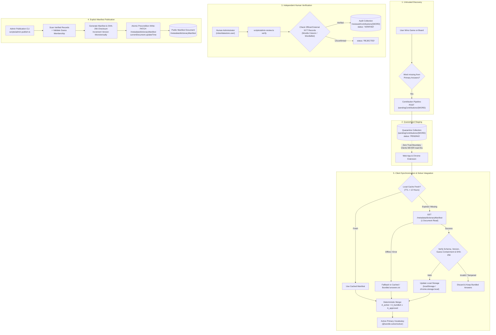
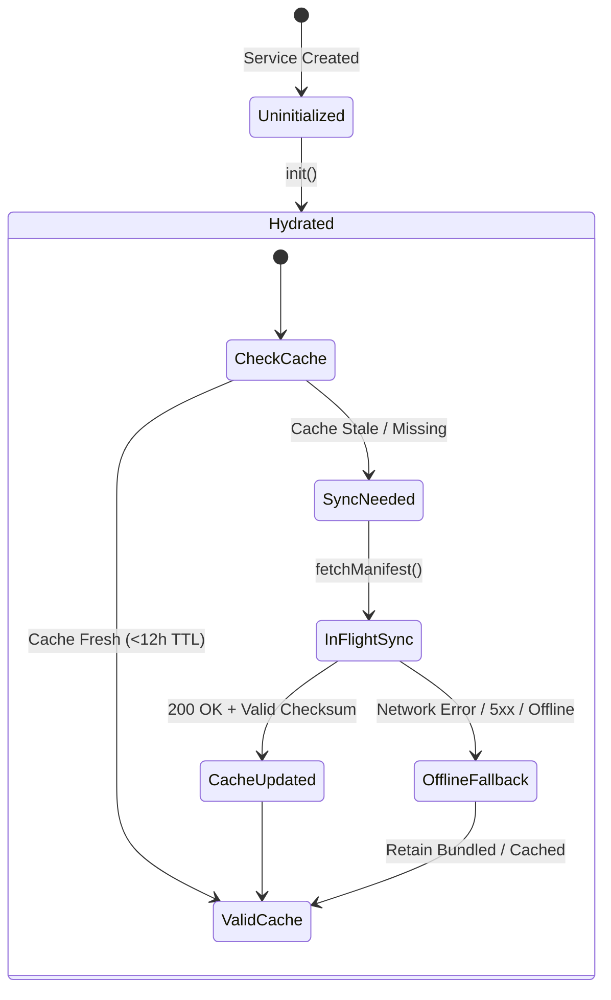

# docs/TRUSTED_DICTIONARY_ARCHITECTURE.md — Trusted Dictionary Architecture & Synchronization

**Document Version:** 1.0.0
**Target Environment:** Firebase Spark Plan (100% Zero-Cost / Offline-First)
**Package:** `@wordle-solver/solver` (`packages/solver`)

---

## 1. Executive Summary & Problem Definition

The **Wordle Solver** engine utilizes a deterministic, information-theoretic decision model based on Shannon entropy, minimax lookahead search, and layered candidate filtering. The baseline engine operates on two static, bundled dictionaries:

1. **Curated Primary Answers (`data/answers.txt`):** 2,315 curated words representing official New York Times (NYT) Wordle solutions.
2. **Allowed Valid Guesses (`data/valid-guesses.txt`):** 12,972 words recognized by the official game client as legitimate submissions.

### The Problem: Wordle Lexicon Evolution
The official New York Times Wordle answer rotation is not entirely frozen. Over time, official puzzle editors periodically introduce new winning solutions (such as `HOLEY`, `SNAFU`, or `TRILL`) that were present in the valid guess dictionary but omitted from the original 2,315-word answer list.

When an unlisted answer occurs:
- The solver's primary candidate pool is exhausted ($|C_{\text{primary}}| = 0$).
- The solver activates its **Layered Candidate Recovery** safety net (`EXPANDED_FALLBACK`), treating all 12,972 valid guesses as potential solutions.
- While the solver can still find the answer, it displays an unverified warning to the user, and lookahead search complexity expands across the 12,972-word space rather than a focused candidate set.

### Architectural Goal
Establish an end-to-end, zero-cost, offline-resilient mechanism to safely integrate human-verified, approved answers into the solver's active primary dictionary across both the web application (`apps/web`) and Chrome extension (`apps/extension`), adhering strictly to:

- **Offline-First Resilience:** Instant client startup ($<1\text{ ms}$) using bundled dictionaries, with zero blocking network dependencies.
- **Zero-Cost Operation:** 100% compliant with the Firebase Spark free quota (no credit card, no Cloud Functions, no billing).
- **Zero-Trust Community Pipeline:** Untrusted player discoveries are quarantined; only independent human-verified records signed by administrators are published.
- **Mathematical Integrity:** Verified answers are promoted to first-class primary candidates, ensuring full minimax proof and entropy optimization.

---

## 2. Zero-Trust Lifecycle & Architecture

The architecture enforces a strict five-phase lifecycle that separates untrusted client telemetry from authoritative dictionary distribution.



### Core Trust Invariants

1. **No Automatic Promotion:** A discovered word is never added to the dictionary automatically, regardless of how many client submissions report it.
2. **Audit vs. Distribution Decoupling:** Review records in `/reviewedContributions` serve as an immutable historical audit log. Dictionary distribution occurs only when an administrator explicitly compiles and publishes a validated manifest to `/metadata/dictionaryManifest`.
3. **Double Verification:** Every candidate word included in a published manifest must independently satisfy:
   - Lexical format: Exactly 5 uppercase ASCII alphabetic characters (`^[A-Z]{5}$`).
   - Lexicon containment: Must exist within the authoritative 12,972-word allowable guess dictionary (`data/valid-guesses.txt`).
   - External audit evidence: Must have an accompanying verified citation from the NYT Wordle Editor or WordleBot review.
4. **Client-Side Defense-in-Depth:** Even if the remote database is compromised, clients independently validate every word against their local bundled `ALL_VALID_GUESSES` and verify the cryptographic SHA-256 digest before merging.
5. **Fail-Closed Offline Fallback:** If synchronization encounters network failure, timeout, invalid JSON, or authorization errors, clients run seamlessly using bundled `data/answers.txt`.

---

## 3. Architectural Alternatives & Trade-Off Analysis

| Dimension | Alternative A: Direct Document Query | Alternative B: Cloud Function Trigger | Alternative C: Static CDN / GitHub Release | Alternative D: Versioned Aggregated Manifest (Selected) |
|---|---|---|---|---|
| **Mechanism** | Clients query `/approvedAnswers` collection directly. | Firestore `onWrite` triggers Cloud Function to compile manifest. | Git commit pushed to repo; GitHub Actions deploys static JSON. | Admin CLI publishes aggregated document to `/metadata/dictionaryManifest`. |
| **Spark Plan Feasibility** | **FAIL.** 1,000 users reading 50 words = 50,000 reads/day (exhausts free quota). | **FAIL.** Cloud Functions require the **Firebase Blaze plan** (billing/credit card). | **PASS.** Free, but requires CI/CD runner and full deployment cycle per word. | **PASS.** 1,000 users = 2,000 reads/day ($<4\%$ of Spark daily quota). |
| **Latency / Update Speed** | Real-time. | Real-time. | High latency (minutes to hours). | Immediate on admin publish. |
| **Client Complexity** | Complex pagination and indexing. | Simple single-document fetch. | Simple single-file fetch. | Simple single-document fetch with local cache. |
| **Offline Resilience** | Poor without heavy cache layer. | Strong with local cache. | Strong with local cache. | Strong with local cache. |
| **Operational Overhead** | None. | High (runtime deployment, billing config). | High (Git repository churn for data updates). | Low (CLI command runs on admin machine). |

### Selected Architecture: Versioned Aggregated Manifest (Alternative D)
- **100% Free & Zero-Cost:** Requires no Cloud Functions, no background microservices, and no credit card.
- **Minimal Read Consumption:** Exactly **1 Firestore document read** per client per 12-hour sync window.
- **Deterministic & Auditable:** Atomic updates guarded by precondition timestamps prevent race conditions.

---

## 4. Schemas & Data Contracts

### 4.1 Remote Manifest Schema (`/metadata/dictionaryManifest`)

Published at the single Firestore path `/metadata/dictionaryManifest`:

```typescript
export interface DictionaryManifest {
  /** Schema identifier for forward compatibility (currently 1) */
  readonly schemaVersion: number;
  /** Monotonically increasing dataset version number (e.g. 1, 2, 3...) */
  readonly dictionaryVersion: number;
  /** ISO 8601 UTC timestamp when this manifest was published */
  readonly publishedAt: string;
  /** Human-readable operator audit label (e.g. "admin_reviewer") */
  readonly publishedBy?: string;
  /** Total count of approved words in this manifest */
  readonly wordCount: number;
  /** Lexicographically sorted array of 5-letter uppercase ASCII approved words */
  readonly words: readonly string[];
  /** SHA-256 hexadecimal digest of canonicalized manifest payload */
  readonly checksum: string;
  /** Optional editorial release notes */
  readonly releaseNotes?: string;
}
```

### 4.2 Canonicalization & Cryptographic Digest (FIPS PUB 180-4)

To guarantee that the manifest checksum can be independently computed and verified across heterogenous environments (Node.js, browser main thread, Web Worker, Chrome Extension background) without whitespace or property-order discrepancies, canonicalization follows strict rules:

1. **Alphabetical Property Ordering:** Keys are serialized strictly in the order:
   `dictionaryVersion`, `publishedAt`, `schemaVersion`, `words`.
2. **Deduplicated & Sorted Word List:** The word array is deduplicated, converted to uppercase ASCII, and sorted lexicographically (`Array.prototype.sort()`).
3. **Compact JSON Serialization:** No formatting whitespace (`JSON.stringify`).
4. **FIPS PUB 180-4 SHA-256:** Checksum is computed using a pure TypeScript implementation of standard SHA-256, returning a 64-character lowercase hexadecimal string.

```typescript
// Canonical payload structure for SHA-256 calculation:
{
  "dictionaryVersion": 2,
  "publishedAt": "2026-10-26T14:00:00.000Z",
  "schemaVersion": 1,
  "words": ["GUANO", "HOLEY", "PSHAW", "SNAFU", "TRILL"]
}
```

### 4.3 Client Local Cache Schema

Stored in platform-native persistent storage (`localStorage` in web, `chrome.storage.local` in Chrome extension):

```typescript
export interface CachedDictionaryManifest {
  readonly manifest: DictionaryManifest;
  /** Local client epoch timestamp (ms) when the manifest was cached */
  readonly cachedAt: number;
  /** Schema version of the cache envelope */
  readonly schemaVersion: 1;
}
```

- **Storage Key:** `wordle_solver_dictionary_manifest_v1`
- **Metadata Key:** `wordle_solver_dictionary_last_sync_time`

---

## 5. Security, Authorization & Concurrency Model

### 5.1 Firestore Security Rules Specification

```javascript
rules_version = '2';
service cloud.firestore {
  match /databases/{database}/documents {

    function isValidWord(word) {
      return word is string && word.size() == 5 && word.matches('^[A-Z]{5}$');
    }

    // 1. Dictionary Manifest: Publicly readable; client writes strictly denied
    match /metadata/dictionaryManifest {
      allow read: if true;
      allow write: if false; // Mutated exclusively via Google Cloud IAM OAuth2 tokens
    }

    // 2. Approved Answers Archive: Publicly readable; client writes strictly denied
    match /approvedAnswers/{word} {
      allow read: if true;
      allow write: if false;
    }

    // 3. Quarantined Contribution Submissions (Stage 9B)
    match /pendingContributions/{word} {
      allow read: if false; // Private queue; reviewed via IAM admin tokens
      allow create: if isValidWord(word)
        && request.resource.data.word == word
        && request.resource.data.solveTurns >= 1
        && request.resource.data.solveTurns <= 6;
      allow update, delete: if false;
    }

    // 4. Administrator Review Audit Records (Stage 9C)
    match /reviewedContributions/{word} {
      allow read, write: if false; // Managed exclusively via IAM admin tokens
    }
  }
}
```

### 5.2 Optimistic Concurrency Control (OCC)

When administrators publish new dictionary versions via `scripts/admin-publish.ts`:
1. The script fetches the existing manifest and extracts its Firestore `updateTime`.
2. The publication update is dispatched via `PATCH /metadata/dictionaryManifest` with an HTTP precondition header:
   `currentDocument.updateTime = <RFC3339_TIMESTAMP>`
3. If a concurrent administrator publish occurred in the interim, the request aborts with `HTTP 412 (Precondition Failed)`, preventing silent overwrites or lost updates.

### 5.3 Client Integrity Defenses

Before any remote manifest is accepted and merged into a client's active vocabulary, `validateManifest` enforces five sequential gates:

1. **Schema Validation:** Verifies required fields, types, and supported `schemaVersion === 1`.
2. **Monotonicity Check:** Verifies `manifest.dictionaryVersion >= active.dictionaryVersion`.
3. **Lexical Validation:** Verifies each word is 5 uppercase ASCII alphabetic characters.
4. **Guess-List Containment:** Every word must be present in the client's bundled `ALL_VALID_GUESSES` (12,972 words). Spurious or non-lexical words are rejected.
5. **Cryptographic Checksum:** Recomputes the SHA-256 digest over the canonical payload and asserts exact hexadecimal equality.

---

## 6. Solver Vocabulary Integration Engine

### 6.1 Primary Merge vs. Secondary Layer

In Stage 8E, the solver established layered candidate recovery:
- `PRIMARY`: Curated candidate answers (`data/answers.txt`, 2,315 words).
- `EXPANDED_FALLBACK`: All allowable guesses (`data/valid-guesses.txt`, 12,972 words).

**Design Decision:** Approved words merge into the **primary candidate pool**:
$$A_{\text{active}} = A_{\text{bundled}} \cup A_{\text{approved}}$$

#### Rationale
- When an answer like `HOLEY` is confirmed by official New York Times records, it is a legitimate daily solution.
- Retaining it in `EXPANDED_FALLBACK` would force the solver to issue unverified warnings to users and compute entropy over 12,972 words rather than focusing on high-probability candidates.
- Adding 10–100 verified words to 2,315 increases the primary candidate set by $<4\%$, maintaining sub-millisecond search latencies.
- Deterministic deduplication ensures $A_{\text{active}}$ contains unique, sorted words.
- If a future puzzle presents a winning word not yet reviewed or published, the solver still seamlessly falls back to `EXPANDED_FALLBACK`.

### 6.2 Web Worker Synchronization (`apps/web`)

1. The UI thread initializes `DictionarySyncService` on mount.
2. The UI retrieves the active primary vocabulary synchronously (`getActiveAnswers()`) and kicks off a background sync (`sync(false)`).
3. The solve request is forwarded to `apps/web/src/worker/solver.worker.ts`, passing the active primary answers.
4. The Web Worker executes `filterByLayeredHistory(activeAnswers, ALL_VALID_GUESSES, history)`.

### 6.3 Chrome Extension Synchronization (`apps/extension`)

1. `apps/extension` implements the storage adapter using `chrome.storage.local`.
2. On popup open, `PopupApp.tsx` reads cached manifest data and resolves active answers.
3. Solving runs directly on the active vocabulary with complete parity to the web application.

---

## 7. Client Synchronization Service (`DictionarySyncService`)

The synchronization service (`packages/solver/src/sync.ts`) is designed to be completely runtime-agnostic, with zero coupling to DOM or Node APIs.

### 7.1 Lifecycle & State Management



### 7.2 Service Capabilities

- **Instant Synchronous Access:** `getActiveAnswers()` immediately returns the active dictionary synchronously without waiting for network or disk I/O.
- **Configurable TTL:** Standard 12-hour synchronization window (`DEFAULT_DICTIONARY_SYNC_TTL_MS = 43,200,000 ms`).
- **Conditional Synchronization:** `sync(false)` checks `lastSyncTime` against the TTL. If fresh, it returns `CACHE_HIT` with zero network overhead.
- **Forced Synchronization:** `sync(true)` bypasses TTL checks to immediately poll for updates.
- **Request Deduplication:** Concurrent invocations of `sync()` share a single in-flight `Promise`.
- **Fault-Tolerant Storage:** Catches and logs persistent storage errors (`QuotaExceededError`, storage permission issues) without crashing the application.

---

## 8. Firebase Spark Quota & Capacity Feasibility

The Firebase Spark plan offers generous free-tier allocations:

| Resource | Spark Free Tier | Stage 9D Daily Consumption (1,000 Users) | Safety Headroom |
|---|---|---|:---:|
| **Firestore Reads** | 50,000 / day | ~2,000 / day (1 read / user / 12h) | **96% remaining** |
| **Firestore Writes** | 20,000 / day | < 10 / week (only when admin publishes) | **>99.9% remaining** |
| **Firestore Storage** | 1 GiB | < 50 KB (manifest + metadata) | **>99.99% remaining** |
| **Network Egress** | 10 GiB / month | ~120 MB / month (2 KB manifest * 60k fetches) | **98.8% remaining** |
| **Cloud Functions** | N/A (Requires Blaze) | **0 invocations (Zero Cloud Functions)** | **Zero Cost** |

**Conclusion:** The aggregated manifest architecture safely operates well within the free tier, ensuring zero hosting costs and complete immunity from surprise billing.

---

## 9. Verification & Testing Matrix

The implementation is verified against an automated test suite covering all trust boundaries and failure modes:

| Test Scenario | Module | Verification Criterion |
|---|---|---|
| **Deterministic SHA-256 Digest** | `manifest.ts` | Recomputes identical 64-character hash across Node.js, Web Worker, and Browser environments. |
| **Tamper Detection** | `manifest.ts` | Altering a single character in a word or timestamp causes `validateManifest` to fail with `CHECKSUM_MISMATCH`. |
| **Vocabulary Containment** | `manifest.ts` | Manifest containing words absent from `valid-guesses.txt` fails validation and is rejected. |
| **Monotonicity Enforcement** | `manifest.ts` | Rejects older manifest version numbers to protect against rollback attacks. |
| **Non-blocking Startup** | `sync.ts` | `getActiveAnswers()` executes synchronously in $<0.1\text{ ms}$ upon initialization. |
| **12-Hour Cache Freshness** | `sync.ts` | Successive calls within the TTL window resolve to `CACHE_HIT` with zero network provider calls. |
| **Offline Resilience** | `sync.ts` | Network disconnects or provider rejections resolve to `OFFLINE_FALLBACK` while preserving cached answers. |
| **Concurrent Deduplication** | `sync.ts` | 5 concurrent `sync()` calls trigger exactly 1 remote fetch. |
| **Storage Error Tolerance** | `sync.ts` | Storage read/write/clear exceptions are trapped gracefully without interrupting solver operation. |

---

## 10. Implementation Status & Component Map

| Component | Location | Status | Description |
|---|---|:---:|---|
| **Manifest Utilities** | `packages/solver/src/manifest.ts` | **Complete** | Canonicalization, SHA-256 hashing, schema validation, and answer merging. |
| **Sync Service** | `packages/solver/src/sync.ts` | **Complete** | Platform-agnostic sync coordinator, cache storage contracts, and offline fallback. |
| **Unit Tests** | `tests/unit/manifest.test.ts`<br/>`tests/unit/sync.test.ts` | **Complete** | 58 dedicated unit tests validating integrity, TTL, and offline resilience. |
| **Web App Integration** | `apps/web/src/services/` | Planned | Hooking `DictionarySyncService` to `localStorage` and passing active answers to Web Worker. |
| **Extension Integration** | `apps/extension/src/services/` | Planned | Hooking `DictionarySyncService` to `chrome.storage.local` in popup. |
| **Publication CLI** | `scripts/admin-publish.ts` | Planned | Administrative tool for querying verified records, computing manifest, and publishing to Firestore. |

---

## 11. Open Architectural Decisions & Risks

Several architectural design considerations and operational risks remain open for future implementation stages:

1. **Storage Model Granularity (`/metadata/dictionaryManifest` vs. `/approvedAnswers/{WORD}`):**
   - *Current Design:* The public client synchronization flow relies entirely on the aggregated `/metadata/dictionaryManifest` document to minimize Firestore read counts under the Firebase Spark quota.
   - *Architectural Consideration:* A granular collection of individual `/approvedAnswers/{WORD}` documents could be maintained in Firestore alongside the compiled manifest document. While clients would continue reading solely the aggregated manifest, individual documents would offer enhanced historical traceability, per-word audit metadata (e.g., specific reviewer identity, original submission timestamps, and editorial notes), and granular document-level access logs. This storage decision is under evaluation and has not yet been implemented in production.

2. **Initial Test & Demonstration Candidates:**
   - For validation, simulation, and offline demonstration of the publication and synchronization pipeline, a representative set of official recent Wordle additions has been identified: `GUANO`, `HOLEY`, `PSHAW`, `SNAFU`, and `TRILL`.
   - *Important Distinction:* These words serve exclusively as deterministic test fixtures for verification and dry-run demonstration. They do not constitute automatically approved production dictionary entries; any real addition to the active primary vocabulary must traverse the independent human review workflow and explicit publication process.

3. **Firebase App Check & Abuse Prevention:**
   - *Security Context:* The dictionary manifest at `/metadata/dictionaryManifest` is designed to be public and read-only, containing non-sensitive word lists. Consequently, unauthorized reads pose zero confidential data leakage risk.
   - *Future Consideration:* To safeguard the Firestore read quota against deliberate scraping or denial-of-service traffic, integrating Firebase App Check (e.g., using reCAPTCHA v3 or Play Integrity / Web App Attestation) remains an architectural option. This represents an optional defense-in-depth consideration rather than an active security control, and is not currently enabled.
